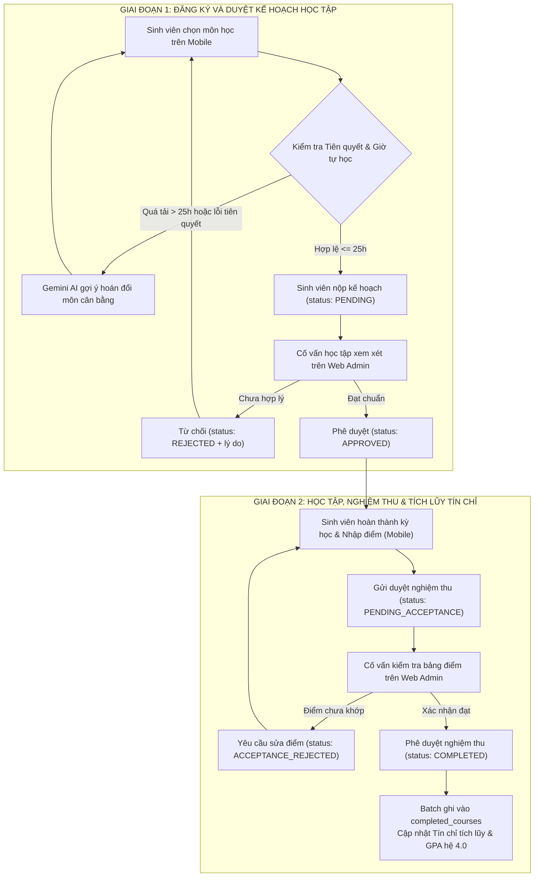
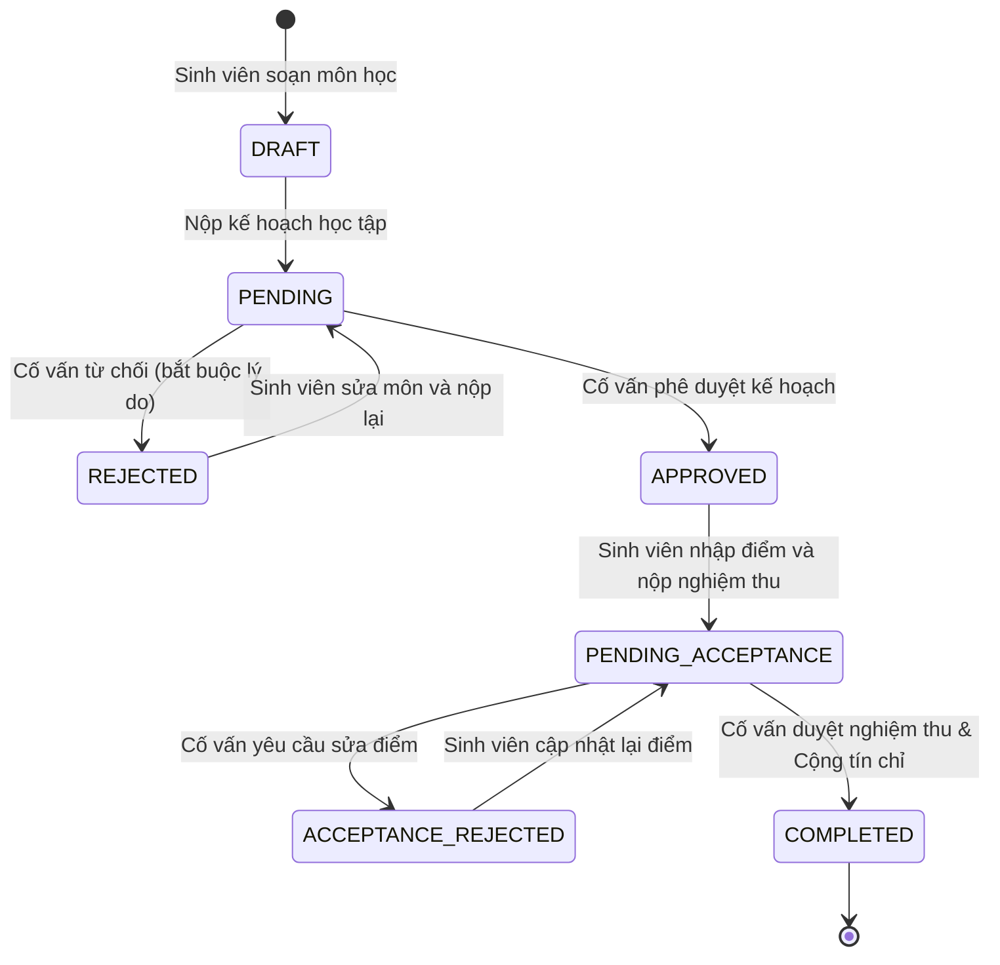
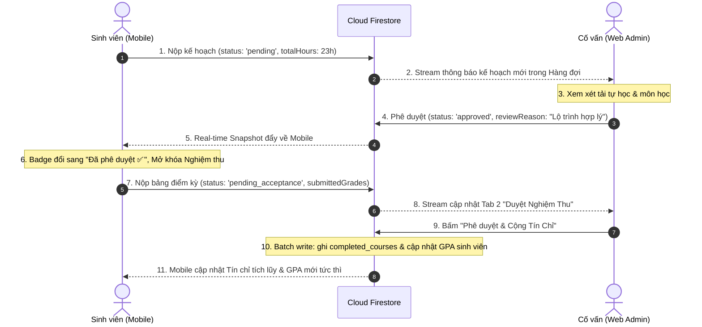
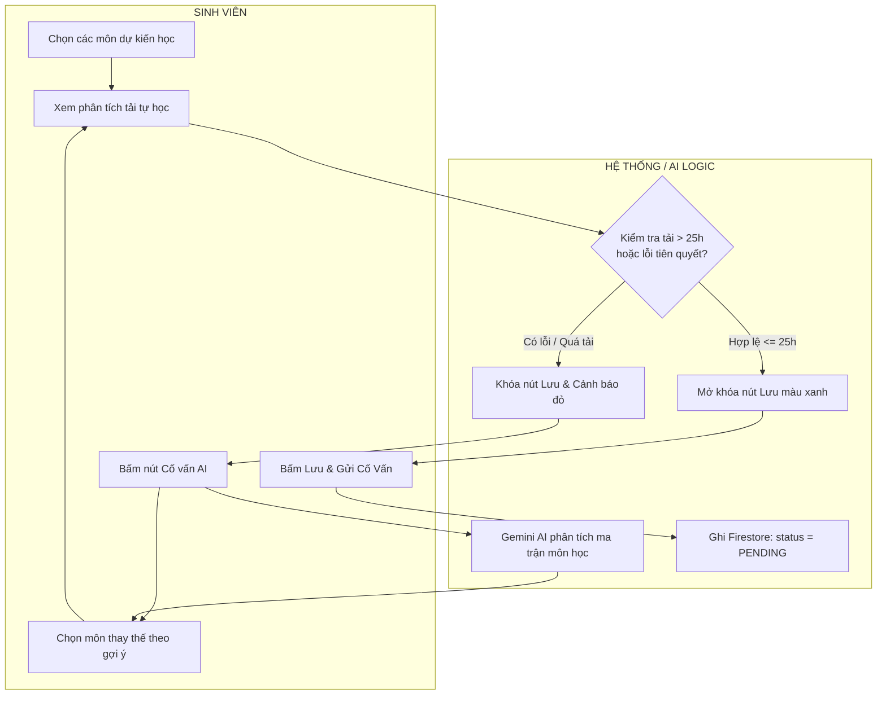

# EduPlan System Specification & Presentation Blueprint
## Đặc tả Hệ thống Toàn diện & Kịch bản Trình bày Đồ án Phần mềm (Chuẩn Guideline V1.0 & Workflow Specification)

> **Dự án**: PRM393 - EduPlan: Hệ thống Lập Kế Hoạch Học Tập & Cố Vấn Học Vụ Thông Minh  
> **Nền tảng**: Flutter Cross-Platform (Mobile App cho Sinh viên & Web Admin Portal cho Cố vấn/Quản trị viên)  
> **Hạ tầng Backend**: Nền tảng Google Firebase (No-Cost Spark Plan) & Trí tuệ Nhân tạo Gemini AI (Firebase AI Logic)  
> **Ngôn ngữ Thiết kế**: Warm Paper Academic Design System (Material Design 3)  
> **Tác giả / Nhóm thực hiện**: Group 4 (Nguyễn Trọng Hiếu & Nhóm)  
> **Căn cứ tài liệu**:
> 1. `Software_Project_Presentation_Guideline_V1.0.pptx` (Chuẩn cấu trúc 4 phần, 24 slide, demo theo workflow, ma trận truy vết).
> 2. `Workflow_La_Gi_Dinh_Nghia_Va_Dac_Ta.pdf` (Đặc tả 7 thành phần chuẩn W10, 5 câu hỏi nhận diện, Activity swimlane, State machine).

---

# CẤU TRÚC TỔNG QUAN BỘ SLIDE BẢO VỆ (24 SLIDES - 4 PHẦN - 18–20 PHÚT)

```
┌────────────────────────────────────────────────────────────────────────────────────────┐
│                        TỔNG THỂ 24 SLIDES BẢO VỆ ĐỒ ÁN EDUPLAN                        │
├─────────────────────┬──────────────────────┬─────────────────────┬─────────────────────┤
│ P1. PROBLEM (3.5')  │  P2. DESIGN (6.0')   │   P3. DEMO (6.5')   │   P4. PROOF (2.5')  │
│  "Tại sao? Cho ai?" │  "Xây thế nào?"      │ "Chạy thật ra sao?" │ "Chứng minh gì?"    │
├─────────────────────┼──────────────────────┼─────────────────────┼─────────────────────┤
│ 01. Overview        │ 07. Business Flow    │ 17. Demo Plan       │ 21. Testing Report  │
│ 02. Context         │ 08. State Machine    │ 18. Demo WF-01      │ 22. Achievements    │
│ 03. Problem         │ 09. Architecture     │ 19. Demo WF-02      │ 23. Limitations     │
│ 04. Solution        │ 10. Tech Stack       │ 20. Demo WF-03      │ 24. Conclusion      │
│ 05. Main Actors     │ 11. UI/UX Warm Paper │                     │                     │
│ 06. Main Features   │ 12. Sequence Diagram │                     │ 25. Phụ lục (Backup)│
│                     │ 13. Class Design     │                     │                     │
│                     │ 14. DB Conceptual    │                     │                     │
│                     │ 15. DB Schema        │                     │                     │
│                     │ 16. Traceability     │                     │                     │
└─────────────────────┴──────────────────────┴─────────────────────┴─────────────────────┘
```

---

# PHẦN 1: BÀI TOÁN & GIẢI PHÁP (PROBLEM & PROPOSED SOLUTION)
> **Ngân sách thời gian**: ≈ 3.5 phút | **Mục tiêu**: Trả lời rõ ràng "Đây là sản phẩm gì, giải quyết nỗi đau nào của ai, và vì sao giải pháp này tối ưu?".

---

### SLIDE 01: Overview — Giới thiệu Dự án trong 30 giây
* **Tiêu đề Slide**: EduPlan — Hệ sinh thái Cố vấn Học tập & Lập Kế hoạch Tín chỉ Thông minh
* **Câu thông điệp kết luận**: *"Giải pháp đồng hành xuyên suốt giúp sinh viên tối ưu hóa lộ trình 145 tín chỉ, triệt tiêu nguy cơ quá tải học tập và gắn kết trực tiếp với Cố vấn học vụ theo thời gian thực."*
* **Nội dung cần trình bày**:
  1. **Tên đề tài**: EduPlan: Smart Academic Planning & Advising Ecosystem.
  2. **Đối tượng sử dụng**: Sinh viên đại học (Mobile Client) và Cố vấn học tập / Ban Đào tạo (Web Admin Portal).
  3. **3 Giá trị cốt lõi**:
     - *Phân tích rủi ro quá tải học tập tự động*: Cảnh báo sớm vượt ngưỡng 25h tự học/tuần và vi phạm môn tiên quyết.
     - *Cố vấn học tập AI linh hoạt*: Tích hợp mô hình Gemini AI thế hệ mới với định dạng JSON có cấu trúc (Structured Output).
     - *Quy trình xét duyệt 2 giai đoạn khép kín*: Duyệt kế hoạch đăng ký môn và duyệt nghiệm thu bảng điểm tích lũy tín chỉ.
  4. **Thông tin định danh**: Môn học PRM393 / Capstone • Group 4.
* **Minh chứng bắt buộc**: Ảnh chụp song song giao diện ứng dụng Mobile trên điện thoại và giao diện Web Admin trên màn hình rộng Desktop.

---

### SLIDE 02: Context — Bối cảnh Đào tạo Tín chỉ Đại học
* **Tiêu đề Slide**: Đào tạo theo Hệ thống Tín chỉ: Linh hoạt nhưng Tiềm ẩn Rủi ro Tự học
* **Câu thông điệp kết luận**: *"Quy chế tín chỉ trao quyền tự chủ tối đa cho sinh viên, nhưng thiếu công cụ mô phỏng tải dẫn đến quyết định đăng ký thiếu cơ sở khoa học."*
* **Nội dung cần trình bày**:
  1. **Quy chế tín chỉ chuẩn**: Để hoàn thành 145 tín chỉ kỹ sư phần mềm trong 9 học kỳ, sinh viên phải tự quản lý thời gian tự học với tỷ lệ chuẩn 1 giờ trên lớp đòi hỏi từ 1.5 – 2.0 giờ tự nghiên cứu tại nhà.
  2. **Thực trạng tại cơ sở giáo dục**: Sinh viên chỉ nhìn thấy "số lượng môn học" hoặc "số tín chỉ" mà không thấy được "khối lượng công việc thực tế (workload)" của từng môn học có độ khó cao.
  3. **Khoảng cách giao tiếp học vụ**: Cố vấn học tập phụ trách hàng trăm sinh viên mỗi khóa, không có công cụ xem trước và phê duyệt kế hoạch trước khi kỳ học chính thức bắt đầu.

---

### SLIDE 03: Problem — Ba Nỗi đau Lớn (Pain Points) Có Minh chứng Số liệu
* **Tiêu đề Slide**: Ba Thách thức Lớn Gây Trễ Hạn Tốt nghiệp & Giảm Sút GPA
* **Câu thông điệp kết luận**: *"Vi phạm môn tiên quyết và quá tải giờ tự học là nguyên nhân trực tiếp dẫn đến rớt môn và kéo dài thời gian tốt nghiệp."*
* **Nội dung cần trình bày**:
  1. **Pain Point 1: Đăng ký sai môn tiên quyết (Prerequisite Violations)**:
     - Sinh viên chọn môn nâng cao khi chưa đạt môn cơ sở (ví dụ: đăng ký `SWT301 - Kiểm thử` khi chưa qua `PRO192`, hoặc đăng ký môn song hành khi chưa đạt kiến thức nền).
     - *Hậu quả*: Bị phòng đào tạo hủy môn muộn, mất học phí hoặc không theo kịp bài giảng.
  2. **Pain Point 2: Hội chứng kiệt sức vì quá tải học tập (Burnout / Overload > 25h/tuần)**:
     - Dồn nhiều môn đồ án nặng (`PRM393`, `SWE302`, `AIE411`) trong cùng một kỳ. Tổng giờ tự học vượt quá 34h/tuần (vượt xa ngưỡng sinh học an toàn 25h/tuần).
     - *Hậu quả*: Tỷ lệ rớt môn chuyên ngành tăng cao, GPA sụt giảm mạnh.
  3. **Pain Point 3: Thiếu kênh giám sát & Nghiệm thu điểm tập trung**:
     - Sinh viên sau khi kết thúc học kỳ không theo dõi được chuẩn xác số tín chỉ đã tích lũy thực tế và thiếu sự xác thực kết quả từ Cố vấn học tập.

---

### SLIDE 04: Proposed Solution — Hệ sinh thái Cố vấn EduPlan
* **Tiêu đề Slide**: EduPlan: Hệ sinh thái Đồng bộ Thời gian thực (Mobile + Web + Firebase + AI)
* **Câu thông điệp kết luận**: *"Giải pháp 'One Firestore, Two Clients' mang lại trải nghiệm cố vấn học vụ khép kín từ lập kế hoạch đến nghiệm thu tín chỉ."*
* **Nội dung cần trình bày**:
  1. **Mobile App (Flutter Mobile - Dành cho Sinh viên)**:
     - Tra cứu 100% môn học với thông số giờ tự học chuẩn xác và điều kiện tiên quyết.
     - Mô phỏng áp lực học tập thời gian thực với đồng hồ đo quá tải (Workload Meter).
     - Trợ lý AI Cố vấn (Gemini AI) phân tích rủi ro và đề xuất phương án hoán đổi môn học tối ưu.
     - Xuất bản vẽ lộ trình học tập khổ A4 ra file PDF có mã xác thực.
  2. **Web Admin Portal (Flutter Web - Dành cho Cố vấn & Quản trị viên)**:
     - Bảng điều khiển KPI học vụ tổng hợp qua truy vấn Firestore Aggregation (`count()`).
     - Hàng đợi xét duyệt 2 giai đoạn: Duyệt kế hoạch học kỳ và Duyệt nghiệm thu bảng điểm.
     - Quản trị toàn diện danh mục môn học (CRUD, phân loại, độ khó, tỷ trọng điểm).
     - Phát hành thông báo học vụ thời gian thực đẩy thẳng xuống chuông điện thoại.
  3. **Hạ tầng Firebase Backend (Spark Plan $0)**:
     - Vận hành không máy chủ với chi phí $0, bảo mật toàn diện bằng bộ quy tắc phân quyền Firestore Security Rules.

---

### SLIDE 05: Main Actors — Ma trận Vai trò Người dùng (RBAC Matrix)
* **Tiêu đề Slide**: Ba Vai trò Nghiệp vụ Phân quyền Chặt chẽ (RBAC)
* **Câu thông điệp kết luận**: *"Bảo mật từ gốc: Kiểm soát quyền hạn đa tầng trên Firebase Auth và Cloud Firestore Security Rules."*
* **Nội dung cần trình bày**:

| Vai trò (Role) | Đối tượng thực tế | Nền tảng sử dụng | Quyền hạn nghiệp vụ chính |
| :--- | :--- | :--- | :--- |
| **`user` (Sinh viên)** | Toàn bộ sinh viên trường | Flutter Mobile App | • Lập kế hoạch, chọn môn, tinh chỉnh mục tiêu điểm.<br>• Tham khảo gợi ý từ Gemini AI Advisor.<br>• Gửi kế hoạch (`pending`) & Nộp bảng điểm nghiệm thu (`pending_acceptance`).<br>• Không được phép tự duyệt kế hoạch hoặc tự cộng tín chỉ. |
| **`staff` (Cố vấn)** | Cố vấn học tập, Giảng viên | Web Admin Portal | • Xét duyệt kế hoạch đăng ký (`approved` / `rejected`).<br>• Xét duyệt nghiệm thu bảng điểm và xác nhận cộng dồn tín chỉ tích lũy.<br>• Thêm mới, chỉnh sửa thông tin môn học; lưu trữ môn học (`archived`).<br>• Soạn và phát hành thông báo học vụ. |
| **`admin` (Quản trị)** | Trưởng ban Đào tạo | Web Admin Portal | • Toàn bộ quyền của `staff`.<br>• Quyền xóa vĩnh viễn (`delete`) môn học tạo nhầm khỏi Firestore.<br>• Quản trị phân quyền tài khoản người dùng (`users/{uid}.role`). |

---

### SLIDE 06: Main Features — Danh mục Tính năng Nhóm theo Workflow
* **Tiêu đề Slide**: Phân rã Tính năng Hệ thống theo 3 Workflow Lõi
* **Câu thông điệp kết luận**: *"Tính năng không đứng rời rạc mà liên kết thành chuỗi giá trị nghiệp vụ hoàn chỉnh."*
* **Nội dung cần trình bày**:
  - **Nhóm tính năng Khám phá & Lập kế hoạch**:
    - `FR-01`: Tra cứu danh mục môn học & Kiểm tra tiên quyết.
    - `FR-02`: Tính toán khối lượng tự học & Cảnh báo quá tải $> 25\text{h/tuần}$.
    - `FR-03`: Trợ lý Gemini AI phân tích chiến lược và hoán đổi môn học.
  - **Nhóm tính năng Xét duyệt & Tương tác Cố vấn**:
    - `FR-04`: Gửi kế hoạch học tập lên Cloud Firestore.
    - `FR-05`: Cố vấn thẩm định kế hoạch, phê duyệt hoặc từ chối kèm nhận xét $\ge 3$ ký tự.
    - `FR-06`: Phát hành và tiếp nhận thông báo học vụ thời gian thực.
  - **Nhóm tính năng Nghiệm thu Kết quả & Xuất Báo cáo**:
    - `FR-07`: Nhập điểm tổng kết kỳ học và gửi yêu cầu nghiệm thu.
    - `FR-08`: Cố vấn xác thực bảng điểm, tự động tính GPA thang 4.0 và cộng tín chỉ tích lũy.
    - `FR-09`: Xuất bản vẽ kế hoạch học tập chuẩn khổ A4 ra file PDF.

---

# PHẦN 2: THIẾT KẾ TOÀN HỆ THỐNG (SYSTEM DESIGN)
> **Ngân sách thời gian**: ≈ 6.0 phút | **Mục tiêu**: Trả lời câu hỏi "Hệ thống được kiến trúc và xây dựng như thế nào? Dữ liệu, luồng nghiệp vụ và bảo mật liên kết với nhau ra sao?".

---

### SLIDE 07: Business Flow — Sơ đồ Luồng Nghiệp vụ Toàn Hệ thống
* **Tiêu đề Slide**: Luồng Nghiệp vụ Học vụ 2 Giai đoạn Khép kín (End-to-End Business Flow)
* **Câu thông điệp kết luận**: *"Sự phối hợp nhịp nhàng giữa Sinh viên trên Mobile và Cố vấn trên Web qua cầu nối dữ liệu Cloud Firestore."*
* **Sơ đồ Mermaid trình bày trên Slide**:



---

### SLIDE 08: State Machine — Vòng đời Trạng thái Đối tượng Kế hoạch (`study_plans`)
* **Tiêu đề Slide**: Máy Trạng thái Vòng đời Kế hoạch Học tập (Study Plan State Machine)
* **Câu thông điệp kết luận**: *"Kiểm soát chuyển trạng thái chặt chẽ: Không một trạng thái nào được phép nhảy cóc hoặc tự phê duyệt trái phép."*
* **Sơ đồ Mermaid State Machine**:



* **Quy tắc chuyển trạng thái bất biến (Business Invariants)**:
  1. `DRAFT` $\to$ `APPROVED`: **BỊ CẤM**. Sinh viên không thể tự phê duyệt kế hoạch của mình.
  2. `APPROVED` $\to$ `COMPLETED`: **BỊ CẤM**. Bắt buộc phải qua trạng thái nộp điểm `PENDING_ACCEPTANCE`.
  3. `PENDING` $\to$ `APPROVED/REJECTED`: **CHỈ CỐ VẤN/ADMIN** được thực hiện, bắt buộc đính kèm nhận xét `reviewReason.size() >= 3`.

---

### SLIDE 09: System Architecture — Kiến trúc Monorepo & Công nghệ Phân tầng
* **Tiêu đề Slide**: Kiến trúc Hệ thống Đồng bộ Monorepo (One Firestore, Two Clients)
* **Câu thông điệp kết luận**: *"Tách biệt rõ ràng giữa logic nghiệp vụ, giao diện người dùng và hạ tầng cơ sở dữ liệu dùng chung."*
* **Sơ đồ phân tầng kiến trúc**:

```
┌────────────────────────────────────────────────────────────────────────────────────────┐
│                                 EDUPLAN MONOREPO                                       │
├────────────────────────────────────────────────────────────────────────────────────────┤
│  1. PRESENTATION LAYER (Giao diện Người dùng)                                          │
│     ├── mobile/ : Flutter Mobile Client (390×800dp) - 8 Màn hình (SCR-01 .. SCR-08)   │
│     └── web/    : Flutter Web Admin Portal (Desktop/Tablet) - 4 Màn hình + 1 Form     │
├────────────────────────────────────────────────────────────────────────────────────────┤
│  2. BUSINESS LOGIC & STATE MANAGEMENT (Tầng Quản lý Trạng thái MVVM)                   │
│     ├── flutter_riverpod (AsyncNotifier, StateNotifier, AutoDisposeProviders)          │
│     ├── PlanAnalyzerViewModel, CourseCatalogViewModel, CompletedCoursesViewModel       │
│     └── ViewModels Web: WebPlanService, WebCourseService, WebAnnouncementService      │
├────────────────────────────────────────────────────────────────────────────────────────┤
│  3. CORE & DOMAIN LAYER (Gói Thực thể & Dịch vụ Dùng chung: packages/core)             │
│     ├── Models: UserModel, StudentProfileModel, CourseModel, StudyPlanModel            │
│     ├── Algorithms: GpaCalculator (Thang 4/10), WorkloadMeter, PrerequisiteGraph       │
│     └── Theme: Warm Paper Design Tokens (AppColors, AppTypography, AppRadius)          │
├────────────────────────────────────────────────────────────────────────────────────────┤
│  4. INFRASTRUCTURE & BACKEND CLOUD LAYER (Nền tảng Firebase Spark $0)                 │
│     ├── Cloud Firestore (NoSQL Real-time) + Firestore Security Rules (RBAC)            │
│     ├── Firebase Authentication (Google Sign-In) + Firebase Remote Config              │
│     ├── Firebase AI Logic (Gemini API) + Firebase Hosting + Analytics & Crashlytics    │
└────────────────────────────────────────────────────────────────────────────────────────┘
```

---

### SLIDE 10: Technology Stack — Bảng Công nghệ đã Hiện thực hóa
* **Tiêu đề Slide**: Công nghệ Triển khai: Tối ưu Hạn mức Spark Plan với Chi phí Vận hành $0
* **Câu thông điệp kết luận**: *"Sử dụng 100% công nghệ hiện đại, không phụ thuộc vào hạ tầng backend trả phí."*
* **Nội dung trình bày**:

| Thành phần kỹ thuật | Công nghệ & Thư viện sử dụng | Vai trò & Giá trị hiện thực hóa |
| :--- | :--- | :--- |
| **Framework Client** | `Flutter SDK ^3.33` & `Dart 3` | Viết 1 lần chạy cả Mobile (Android/iOS) và Web Desktop mượt mà. |
| **Quản lý Trạng thái** | `flutter_riverpod ^3.4.3` | Mô hình MVVM đơn luồng dữ liệu (Unidirectional Data Flow), phản ứng tức thì. |
| **Cơ sở Dữ liệu** | `cloud_firestore ^7.1.0` | Đồng bộ dữ liệu 2 chiều thời gian thực qua WebSockets/Streams. |
| **Xác thực Người dùng** | `firebase_auth ^7.0.1` | Google Sign-In an toàn, phân định không gian dữ liệu riêng theo `uid`. |
| **Cấu hình Từ xa** | `firebase_remote_config` | Đổi ngưỡng quá tải 25h, bật/tắt AI, cập nhật model `gemini-3.8-flash` không cần build lại app. |
| **Trí tuệ Nhân tạo** | `Gemini 3.8 Flash & DeepSeek` | Cố vấn AI đa tầng (Gemini 3.8 Flash -> DeepSeek-V3 -> Local Rule-Engine), Zero-PII, JSON Schema. |
| **Engine Xuất Bản vẽ** | `pdf ^3.11.3` & `printing` | Sinh bản vẽ kế hoạch khổ A4 trực tiếp trên thiết bị (không cần Cloud Storage). |
| **Hosting & Phân phối** | `Firebase Hosting` | Triển khai Web Admin toàn cầu với CDN tốc độ cao và SSL miễn phí. |

---

### SLIDE 11: UI/UX Design System — Warm Paper Academic Design
* **Tiêu đề Slide**: Warm Paper Academic Design: Thân thiện, Khoa học & Chuẩn Accessibility
* **Câu thông điệp kết luận**: *"Hệ thống màu sắc ngà ấm giảm căng thẳng thị giác, tối ưu cho hoạt động học tập kéo dài."*
* **Nội dung trình bày**:
  1. **Bảng màu chủ đạo (Color Palette)**:
     - `Canvas Background` (`#FBF6EB`): Màu giấy kem ngà tự nhiên, dịu mắt hơn nền trắng gắt.
     - `Card / Surface` (`#FFFDF7`): Trắng ngà nhẹ nhàng, viền nét mảnh `1px solid #EAE1D0`.
     - `Primary Royal Blue` (`#2563EB`): Màu xanh hoàng gia nổi bật làm điểm nhấn CTA và tiêu đề.
     - `Status Colors`: Xanh lá thành công (`#15803D`), Đỏ cảnh báo quá tải (`#DC2626`), Vàng chờ duyệt (`#78350F`).
  2. **Tiêu chuẩn Tiếp cận (Accessibility / WCAG 2.1 AA)**:
     - Toàn bộ các thẻ bấm đều có `Semantics` với nhãn giải thích rõ ràng cho Screen Readers.
     - Đảm bảo tỷ lệ tương phản chữ/nền tối thiểu $\ge 4.5:1$.
     - Vùng chạm tối thiểu đạt chuẩn $\ge 48 \times 48\text{dp}$.

---

### SLIDE 12: Sequence Diagram — Tương tác Thời gian thực Mobile ⇄ Web
* **Tiêu đề Slide**: Sequence Diagram: Luồng Tương tác Dữ liệu Thời gian thực Hai Chiều
* **Câu thông điệp kết luận**: *"Dữ liệu cập nhật từ Web Admin phản ánh ngay lập tức trên màn hình Mobile của Sinh viên."*
* **Sơ đồ Mermaid Sequence**:



---

### SLIDE 13: Class Design & MVVM Architecture
* **Tiêu đề Slide**: Mô hình Lớp Đối tượng & Thiết kế Kiến trúc MVVM
* **Câu thông điệp kết luận**: *"Phân tách trách nhiệm mạch lạc giữa Thực thể (Model), Điều phối (ViewModel) và Dịch vụ (Service)."*
* **Nội dung trình bày**:
  1. **Tầng Models**:
     - `CourseModel`: Đại diện môn học, tín chỉ, giờ tự học, tỷ trọng điểm, môn tiên quyết.
     - `StudyPlanModel`: Quản lý danh sách môn chọn, tải tự học, trạng thái duyệt, bảng điểm `submittedGrades`.
     - `StudentProfileModel`: Hồ sơ sinh viên, số tín chỉ tích lũy, GPA hiện tại, GPA mục tiêu.
     - `AnnouncementModel`: Cấu trúc thông báo học vụ đẩy về Mobile.
  2. **Tầng ViewModels (Riverpod Notifiers)**:
     - `PlanAnalyzerViewModel`: Xử lý thêm/bớt môn, tính tải tự học, phát hiện xung đột, giao tiếp với Gemini AI.
     - `CourseCatalogViewModel`: Xử lý tìm kiếm môn học, lọc danh mục và lọc môn thỏa mãn tiên quyết.
     - `CompletedCoursesViewModel`: Quản lý các môn đã hoàn thành và danh sách môn đang chờ nghiệm thu.
  3. **Tầng Services**:
     - `PlanService`, `StudentService`, `CourseService`, `AiAdvisorService`, `WebPlanService`.

---

### SLIDE 14 & 15: Database Schema — Thiết kế CSDL Cloud Firestore
* **Tiêu đề Slide**: Thiết kế CSDL NoSQL Cloud Firestore & Cơ chế Phân vùng Dữ liệu
* **Câu thông điệp kết luận**: *"Cấu trúc collection phân tán, đánh index tối ưu và hỗ trợ truy vấn tổng hợp thời gian thực."*
* **Mô hình Dữ liệu Chi tiết**:

```
firebasestorage: prm393-eduplan
├── users/{uid}                     [Thông tin tài khoản & Role RBAC]
│   ├── email: string
│   ├── displayName: string
│   └── role: "user" | "staff" | "admin"
│
├── students/{uid}                  [Hồ sơ học vụ sinh viên]
│   ├── fullName: string
│   ├── studentId: string (e.g. SE180504)
│   ├── accumulatedCredits: int (e.g. 90)
│   ├── totalGraduationCredits: int (145)
│   ├── currentGpa: number (e.g. 3.45)
│   ├── targetGpa: number (e.g. 3.65)
│   ├── passedCourseCodes: list<string> ["PRO192", "CSD201", ...]
│   └── completed_courses/{sem_code} [Subcollection môn đã học & điểm số]
│       ├── code, name, credits, grade (0-10), gradeLetter, isPassed
│
├── courses/{courseCode}            [Danh mục môn học toàn trường]
│   ├── code: string (<= 12 chars, in hoa)
│   ├── name: string (<= 120 chars)
│   ├── credits: int (1..10)
│   ├── defaultSelfStudyHours: double (giờ tự học gợi ý)
│   ├── prerequisiteCode: string (mã môn tiên quyết)
│   ├── difficulty: double (1.0 - 5.0)
│   ├── assessmentBreakdown: map {assignment, lab, pe, fe} (tổng = 100%)
│   ├── studyTips: list<string>
│   └── status: "published" | "draft" | "archived"
│
├── study_plans/{planId}            [Kế hoạch học tập từng kỳ]
│   ├── userId, studentName, studentCode, semesterName
│   ├── courses: list<map> (danh sách môn chọn)
│   ├── totalCredits, totalSelfStudyHours, maxSafeThresholdHours (25h)
│   ├── status: "draft" | "pending" | "approved" | "rejected" | "pending_acceptance" | "completed"
│   ├── reviewReason: string (nhận xét của Cố vấn, size >= 3)
│   ├── submittedGrades: list<map> (bảng điểm nộp nghiệm thu)
│   └── pdfExportedAt: timestamp
│
└── announcements/{id}              [Thông báo học vụ]
    ├── title, body, category, targetSemester, authorName
    └── status: "published" | "archived"
```

---

### SLIDE 16: Traceability Matrix — Ma trận Truy vết Toàn diện
* **Tiêu đề Slide**: Ma trận Truy vết: Từ Nỗi đau Bài toán đến Kiểm thử Chức năng
* **Câu thông điệp kết luận**: *"Mỗi dòng mã và mỗi bài test đều truy nguyên trực tiếp từ một yêu cầu nghiệp vụ thực tế."*
* **Bảng Ma trận Truy vết**:

| Mã Pain Point | Yêu cầu Nghiệp vụ (FR) | Thành phần Thiết kế (UI / Service) | Workflow Lõi | Bài Test Xác minh |
| :--- | :--- | :--- | :---: | :---: |
| **P-01: Lỗi môn tiên quyết** | `FR-01`: Cảnh báo và chặn môn chưa đạt tiên quyết | `CourseCatalogScreen`<br>`PlanAnalyzerViewModel` | **WF-01** | `test/course_catalog_test.dart`<br>`test/uc36_analytics_test.dart` |
| **P-02: Quá tải giờ tự học** | `FR-02`: Đo tải học tập & Cảnh báo $> 25\text{h}$ | `WorkloadMeter`<br>`SelectedCoursesScreen` | **WF-01** | `test/selected_courses_test.dart`<br>`test/unit_test.dart` |
| **P-02: Thiếu chiến lược học** | `FR-03`: Gemini AI phân tích & đề xuất môn | `AiAdvisorService`<br>`PlanAnalyzerScreen` | **WF-01** | `test/ai_advisor_test.dart` |
| **P-03: Thiếu kênh duyệt lộ trình** | `FR-05`: Cố vấn duyệt / từ chối kế hoạch | `ReviewsScreen (Tab 1)`<br>`WebPlanService` | **WF-02** | `firebase/tests/rules.test.js`<br>(Rule R-05, R-06, R-07) |
| **P-03: Thất thoát tiến độ tín chỉ** | `FR-08`: Nghiệm thu điểm & tích lũy tín chỉ | `ReviewsScreen (Tab 2)`<br>`SemesterSummaryScreen` | **WF-03** | `test/semester_summary_test.dart`<br>`test/account_switching_isolation_test.dart` |

---

# PHẦN 3: KỊCH BẢN DEMO THEO WORKFLOW (DEMO SCRIPT)
> **Ngân sách thời gian**: ≈ 6.5 phút | **Mục tiêu**: Kể một câu chuyện End-to-End sống động qua 3 Workflow lõi, có người dùng thật, thao tác thật, xử lý ngoại lệ và kết quả quan sát được trên màn hình.

---

### SLIDE 17: Demo Plan — Kịch bản Kể chuyện Liền mạch (End-to-End Storyline)
* **Tiêu đề Slide**: Kịch bản Demo: Hành trình Đồng hành Kỳ học của Sinh viên & Cố vấn
* **Câu thông điệp kết luận**: *"Trình diễn sự kết nối thực tế xuyên suốt giữa Sinh viên trên Mobile và Cố vấn trên Web Admin."*
* **Hành trình câu chuyện Demo**:
  - **Nhân vật**: Sinh viên Nguyễn Trọng Hiếu (MSSV `SE180504`, chuẩn bị bước vào Học kỳ 5) và Thầy Cố vấn Đào tạo (Tài khoản Web Admin).
  - **Cảnh 1 (WF-01 trên Mobile)**: Sinh viên chọn môn, phát hiện quá tải $34\text{h/tuần}$, nhờ Gemini AI tư vấn đổi môn cân bằng về $26\text{h/tuần}$, gửi kế hoạch lên Cloud.
  - **Cảnh 2 (WF-02 trên Web Admin)**: Thầy Cố vấn mở Web Admin, thấy kế hoạch trong hàng đợi, xem xét tải tự học và bấm phê duyệt kế hoạch. Mobile nhận thông báo ngay lập tức.
  - **Cảnh 3 (WF-03 Kết thúc kỳ)**: Sinh viên thi xong, nhập bảng điểm trên Mobile và gửi duyệt nghiệm thu. Thầy Cố vấn kiểm tra bảng điểm trên Web, phê duyệt và hệ thống tự động cộng dồn tín chỉ tích lũy lên hồ sơ.

---

### SLIDE 18: Demo WF-01 — Lập Kế Hoạch Học Tập & Phân Tích Tải Thông Minh (Mobile)
* **Tiêu đề Slide**: WF-01: Lập Kế Hoạch Học Tập Kỳ Mới & Tinh Chỉnh Cân Bằng với AI
* **Bảng Đặc tả 7 Thành phần Chuẩn W10**:

| Trường đặc tả | Nội dung chi tiết |
| :--- | :--- |
| **Mã & Tên Workflow** | **WF-01 · Lập kế hoạch học tập kỳ mới** |
| **Actor tham gia** | Sinh viên (chủ động), Trợ lý Gemini AI, Hệ thống EduPlan |
| **Trigger (Sự kiện khởi động)** | Sinh viên mở màn hình Tìm môn (`SCR-04`) và chọn môn vào kỳ học mới. |
| **Precondition (Điều kiện tiên quyết)** | Sinh viên đã đăng nhập tài khoản; kế hoạch ở trạng thái `DRAFT`. |
| **Happy Path (Luồng chính 4 bước)** | 1. Sinh viên thêm các môn học dự kiến vào kế hoạch.<br>2. Hệ thống tính toán tổng giờ tự học và hiển thị trên đồng hồ Workload Meter.<br>3. Nếu tổng tải $\le 25\text{h/tuần}$, nút "Lưu Kế Hoạch" mở khóa màu xanh.<br>4. Sinh viên bấm Lưu $\to$ Kế hoạch ghi lên Firestore với trạng thái `PENDING`. |
| **Exception (Nhánh rẽ & Ngoại lệ)** | • *Ngoại lệ 1 (Quá tải > 25h)*: Đồng hồ báo đỏ, nút Lưu bị khóa. Sinh viên bấm "Cố vấn AI", Gemini AI phân tích và gợi ý đổi sang môn học nhẹ hơn để đạt cân bằng.<br>• *Ngoại lệ 2 (Lỗi tiên quyết)*: Hệ thống hiển thị viền đỏ cảnh báo môn chưa học tiên quyết, ngăn chặn lưu. |
| **Postcondition (Kết quả đạt được)** | Kế hoạch chuyển sang trạng thái `PENDING`; Cố vấn nhận được yêu cầu trong hàng đợi; Sinh viên có bản kế hoạch hợp lệ. |
| **Mã truy vết liên quan** | `FR-01`, `FR-02`, `FR-03` · `SCR-04`, `SCR-06A`, `SCR-06B` · `PlanService` · `TC-01..TC-08` |

* **Sơ đồ Activity Diagram Swimlane của WF-01**:



---

### SLIDE 19: Demo WF-02 — Xét Duyệt Kế Hoạch Học Tập (Web Admin Portal)
* **Tiêu đề Slide**: WF-02: Xét Duyệt Kế Hoạch Đăng Ký Môn Học (Web Admin Portal)
* **Bảng Đặc tả 7 Thành phần Chuẩn W10**:

| Trường đặc tả | Nội dung chi tiết |
| :--- | :--- |
| **Mã & Tên Workflow** | **WF-02 · Xét duyệt kế hoạch đăng ký môn** |
| **Actor tham gia** | Cố vấn học tập (Web Admin), Hệ thống Cloud Firestore |
| **Trigger (Sự kiện khởi động)** | Sinh viên gửi kế hoạch lên Cloud Firestore (kế hoạch mang trạng thái `PENDING`). |
| **Precondition (Điều kiện tiên quyết)** | Cố vấn đã đăng nhập tài khoản có vai trò `staff` hoặc `admin`; kế hoạch ở trạng thái `PENDING`. |
| **Happy Path (Luồng chính 4 bước)** | 1. Cố vấn mở Hàng đợi duyệt (`WEB-04 - Tab 1`), xem danh sách môn và biểu đồ tải của sinh viên.<br>2. Cố vấn bấm "Phê duyệt Kế Hoạch".<br>3. Cố vấn nhập nhận xét hướng dẫn (tối thiểu 3 ký tự hoặc chọn chip gợi ý nhanh).<br>4. Hệ thống cập nhật kế hoạch sang `APPROVED`; Mobile của sinh viên đổi badge xanh tức thì. |
| **Exception (Nhánh rẽ & Ngoại lệ)** | • *Cố vấn phát hiện bất hợp lý*: Cố vấn bấm "Yêu Cầu Sửa", nhập lý do từ chối cụ thể $\to$ Kế hoạch chuyển sang `REJECTED`. Mobile sinh viên hiện banner đỏ kèm lời dặn của Cố vấn để sửa lại. |
| **Postcondition (Kết quả đạt được)** | Kế hoạch đổi sang `APPROVED` hoặc `REJECTED`, có đầy đủ lịch sử duyệt (`reviewedBy`, `reviewedAt`, `reviewReason`). |
| **Mã truy vết liên quan** | `FR-05` · `WEB-04` · `WebPlanService` · `TC-09..TC-14` |

---

### SLIDE 20: Demo WF-03 — Nghiệm Thu Kết Quả Kỳ Học & Tích Lũy Tín Chỉ (Cross-Client)
* **Tiêu đề Slide**: WF-03: Nghiệm Thu Kết Quả Kỳ Học & Tích Lũy Tín Chỉ Tốt Nghiệp
* **Bảng Đặc tả 7 Thành phần Chuẩn W10**:

| Trường đặc tả | Nội dung chi tiết |
| :--- | :--- |
| **Mã & Tên Workflow** | **WF-03 · Nghiệm thu kết quả học kỳ và tích lũy tín chỉ** |
| **Actor tham gia** | Sinh viên (Mobile), Cố vấn học tập (Web Admin), Cloud Firestore |
| **Trigger (Sự kiện khởi động)** | Sinh viên hoàn thành kỳ học, bấm nút nghiệm thu và nhập điểm tổng kết trên Mobile (`SCR-07`). |
| **Precondition (Điều kiện tiên quyết)** | Kế hoạch học kỳ phải ở trạng thái `APPROVED` (không cho phép nghiệm thu kế hoạch chưa được duyệt). |
| **Happy Path (Luồng chính 5 bước)** | 1. Sinh viên nhập điểm các môn (thang điểm 10) và bấm "Gửi Cố vấn duyệt nghiệm thu".<br>2. Kế hoạch chuyển trạng thái sang `PENDING_ACCEPTANCE`, lưu mảng `submittedGrades`.<br>3. Cố vấn mở Web Admin (`WEB-04 - Tab 2`), kiểm tra bảng điểm và tỷ lệ qua môn.<br>4. Cố vấn bấm "Phê Duyệt Nghiệm Thu & Cộng Tín Chỉ".<br>5. Hệ thống thực hiện Batch Write: ghi môn vào `completed_courses`, tự động tính GPA thang 4.0, tăng tín chỉ tích lũy của sinh viên và chuyển kế hoạch sang `COMPLETED`. |
| **Exception (Nhánh rẽ & Ngoại lệ)** | • *Điểm nhập sai lệch*: Cố vấn bấm "Yêu Cầu Sửa Điểm", nhập lý do $\to$ Kế hoạch chuyển sang `ACCEPTANCE_REJECTED`. Sinh viên nhận được yêu cầu trên Mobile để chỉnh sửa và gửi lại. |
| **Postcondition (Kết quả đạt được)** | Hồ sơ sinh viên trên Firestore được cộng dồn tín chỉ chính thức; GPA cập nhật; mở khóa các môn tiên quyết tiếp theo. |
| **Mã truy vết liên quan** | `FR-07`, `FR-08` · `SCR-07`, `WEB-04` · `StudentService`, `WebPlanService` · `TC-15..TC-22` |

---

# PHẦN 4: MINH CHỨNG & KẾT LUẬN (PROOF & CONCLUSION)
> **Ngân sách thời gian**: ≈ 2.5 phút | **Mục tiêu**: Đưa ra số liệu kiểm thử thực tế chứng minh tính ổn định, tự đánh giá thẳng thắn các giới hạn và kết lại bằng 3 thông điệp đắt giá nhất.

---

### SLIDE 21: Testing & Quality Assurance — Báo Cáo Kiểm Thử Toàn Diện
* **Tiêu đề Slide**: Kết Quả Kiểm Thử Độc Lập: 100% Test Cases Passed
* **Câu thông điệp kết luận**: *"Chất lượng phần mềm được bảo chứng bằng kiểm thử đa tầng: Unit test, Widget test, Semantics WCAG và Security Rules Emulator."*
* **Số liệu Minh chứng Thực tế**:
  1. **Mobile Automated Tests (`flutter test`)**:
     - **74 / 74 Test Cases Passed (100%)** trên toàn bộ 15 file test độc lập (đã bổ sung kiểm thử tích hợp `test/ai_advisor_test.dart` cho Cố vấn AI).
     - Bao gồm smoke test, kiểm tra cách ly dữ liệu đa tài khoản (`account_switching_isolation_test`), kiểm thử ngữ nghĩa trợ năng WCAG (`uc37_semantics_test`), kiểm thử đồng bộ Analytics (`uc36_analytics_test`), kiểm thử Cố vấn AI (`ai_advisor_test`).
  2. **Web Admin Portal Tests (`flutter test web_admin_test.dart`)**:
     - **4 / 4 Test Suites Passed (100%)** xác thực: WebLoginScreen (Google Sign-In & Demo Staff/Admin), WebShellScaffold (Sidebar, Role Gate, Navigation Rail), KpiCard, AppAlertBanner.
  3. **Firestore Security Rules Emulator Tests (`mocha / firebase emulator`)**:
     - **17 / 17 Rules Test Cases Passed (100%)** với cấu hình nghiêm ngặt (`rules.test.js`).
     - Xác minh: Chặn đứng sinh viên tự duyệt kế hoạch, chặn sinh viên tự đổi role, kiểm tra bắt buộc lý do duyệt $\ge 3$ ký tự.
  4. **Tĩnh phân tích mã nguồn (Static Code Analysis)**:
     - `dart analyze lib test` (Mobile): **0 Errors, 0 Warnings**.
     - `dart analyze lib test` (Web Admin Portal): **0 Issues found**.
     - `flutter build web`: **Thành công 100%**.

---

### SLIDE 22: Achievements — Đối Chiếu Kết Quả với Mục Tiêu Đồ Án
* **Tiêu đề Slide**: Kết Quả Đạt Được So Với Mục Tiêu Đặt Ra
* **Câu thông điệp kết luận**: *"Hiện thực hóa đầy đủ 100% yêu cầu đồ án theo đúng tiêu chuẩn công nghiệp."*
* **Bảng đối chiếu mục tiêu**:

| Mục tiêu đề tài | Hiện trạng thực tế đã hoàn thành | Minh chứng kỹ thuật |
| :--- | :--- | :--- |
| **1. Đa nền tảng Khép kín** | Hoàn thành cả Mobile App (Android/iOS) và Web Admin Portal đồng bộ dữ liệu thời gian thực. | 8 màn hình Mobile + 4 màn hình Web + 1 Form |
| **2. Cố vấn Trí tuệ Nhân tạo** | Tích hợp thành công Gemini AI thế hệ mới với Structured Output (JSON) và cơ chế Fallback an toàn. | `AiAdvisorService`, zero PII leak |
| **3. Bảo mật Phân quyền** | Triển khai RBAC 3 vai trò (`user`, `staff`, `admin`) bằng Firestore Rules đã kích hoạt trên Cloud. | Rules version live `Today • 10:12 PM` |
| **4. Báo cáo Chuẩn Hóa** | Xuất bản vẽ lộ trình học tập khổ A4 ra file PDF trực tiếp trên thiết bị với mã định danh kế hoạch. | `PdfExportService`, chuẩn in ấn vector |

---

### SLIDE 23: Limitations & Next Steps — Đánh Giá Trung Thực & Hướng Phát Triển
* **Tiêu đề Slide**: Giới Hạn Thực Tế & Định Hướng Phát Triển Tiếp Theo
* **Câu thông điệp kết luận**: *"Nhìn nhận thẳng thắn các điểm chưa hoàn hảo để có lộ trình nâng cấp thiết thực."*
* **Bảng Đánh giá Giới hạn & Giải pháp**:

| Giới hạn hiện tại | Đánh giá tác động | Mức ưu tiên | Hướng xử lý tiếp theo |
| :--- | :--- | :---: | :--- |
| **1. Chưa hỗ trợ đa chương trình đào tạo** | Hiện tại hệ thống tập trung sâu vào khung chương trình Kỹ thuật Phần mềm (SE 145 TC). | Trung bình | Xây dựng trình kéo-thả cấu trúc khung chương trình linh hoạt cho mọi ngành học (AI, IS, IA). |
| **2. Phụ thuộc kết nối mạng khi gọi AI** | Khi mất mạng hoàn toàn, tính năng AI phải chuyển sang chế độ dự phòng bằng luật tĩnh (Rule-based). | Thấp | Tích hợp mô hình ngôn ngữ nhỏ chạy trực tiếp trên thiết bị (On-Device Gemini Nano / SLM). |
| **3. Chưa tích hợp hệ thống thanh toán học phí** | Học phí hiện tại mới ở mức dự toán chính xác (1.140.000đ/TC), chưa liên kết cổng thanh toán ngân hàng. | Trung bình | Tích hợp cổng thanh toán trực tuyến VNPAY/MoMo trong giai đoạn 2. |

---

### SLIDE 24: Conclusion — Ba Thông Điệp Then Chốt Gửi Tới Hội Đồng
* **Tiêu đề Slide**: EduPlan: Nền Tảng Định Hình Tương Lai Cố Vấn Học Vụ Số
* **Câu thông điệp kết luận**: *"EduPlan không chỉ là đồ án môn học, mà là một sản phẩm hoàn thiện, có khả năng ứng dụng thực tiễn ngay tại các trường đại học đào tạo theo tín chỉ."*
* **3 Thông điệp Đắt Giá Nhất**:
  1. **TÍNH THỰC TIỄN CAO**: Giải quyết triệt để bài toán quá tải học tập và rớt môn của sinh viên bằng công nghệ mô phỏng giờ tự học và trợ lý Gemini AI.
  2. **KIẾN TRÚC VỮNG CHẮC**: Mô hình đồng bộ thời gian thực hai chiều giữa Mobile và Web Admin trên nền tảng Firebase không máy chủ với chi phí vận hành $0.
  3. **CHẤT LƯỢNG ĐÃ ĐƯỢC KIỂM CHỨNG**: 100% Test Cases và Security Rules được xác thực tự động, quy trình xét duyệt 2 giai đoạn minh bạch, chuẩn mực.
* **Thông tin liên kết minh chứng**:
  - Mã nguồn Github: `https://github.com/BeraT0u/PRM393-LAB3-Group4`
  - Web Admin Hosting URL: `https://prm393-eduplan.web.app`

---

# PHẦN PHỤ LỤC BACKUP (SLIDE 25 - SẴN SÀNG KHI HỘI ĐỒNG HỎI SÂU)

1. **A1 · Chi tiết Thuật toán Tính GPA**:
   - Chuyển đổi điểm hệ 10 sang hệ 4 theo thang điểm chuẩn FPT: $\ge 8.5 \to 4.0$ (Điểm A), $\ge 8.0 \to 3.5$ (B+), $\ge 7.0 \to 3.0$ (B), $\ge 6.5 \to 2.5$ (C+), $\ge 5.5 \to 2.0$ (C), $\ge 5.0 \to 1.5$ (D+), $\ge 4.0 \to 1.0$ (D), $< 4.0 \to 0.0$ (F).
   - Công thức tính GPA tích lũy: $\text{GPA} = \frac{\sum (\text{Điểm hệ 4} \times \text{Số TC})}{\sum \text{Số TC}}$ trên toàn bộ môn đã đạt ($\text{điểm} \ge 4.0$).
2. **A2 · Cơ chế Bảo vệ Quyền Riêng tư với AI (Privacy Guard)**:
   - Module `AiPrivacyGuard` tự động lọc bỏ toàn bộ thông tin cá nhân: Họ tên, Email, MSSV, Số điện thoại. AI chỉ nhận danh sách mã môn, điểm mục tiêu và số giờ tự học.
3. **A3 · Bằng chứng Kiểm thử Bảo mật Firestore Rules**:
   - 17 test cases độc lập mô phỏng sinh viên cố tình ghi đè `role: "admin"`, sinh viên cố tình tự cập nhật `status: "approved"`, Cố vấn duyệt thiếu lý do $\to$ tất cả đều bị Firebase Engine từ chối với lỗi `PERMISSION_DENIED`.
