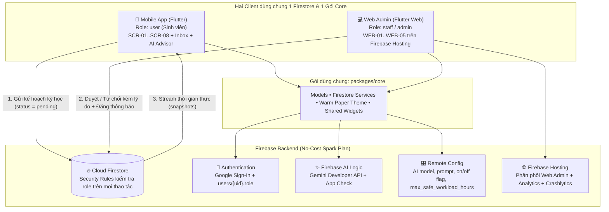
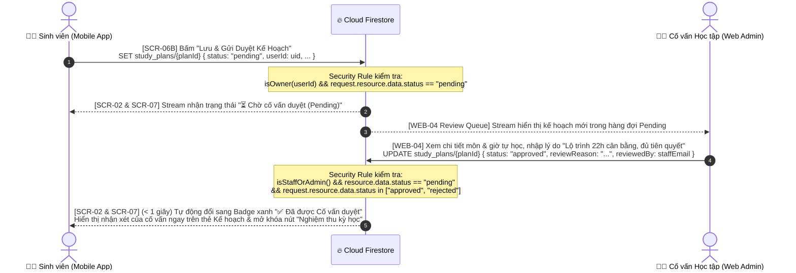

# Handoff — EduPlan Complete System (Final Assignment) — Mobile + Web Admin + Firebase + Gemini AI

Tài liệu đặc tả kỹ thuật toàn diện cho **PRM393 Final Assignment: One Complete System on Firebase**, hợp nhất thiết kế **Lab 2** (`Warm Paper Academic Design System`) và ứng dụng **Lab 3** (`EduPlan Mobile`) thành một hệ sinh thái hoàn chỉnh gồm: **Flutter Mobile App**, **Flutter Web Admin**, **Shared Core Package (`packages/core`)**, **Firebase Backend (Firestore + Security Rules + Hosting + Remote Config + App Check + Analytics + Crashlytics)** và **Gemini AI (Firebase AI Logic)**.

| Thông số | Giá trị chuẩn |
| --- | --- |
| **Tên dự án / Repo** | `PRM393_Final_Group4` — **EduPlan: Hệ thống Lập kế hoạch & Cố vấn Học tập Thông minh** |
| **Clients** | **Mobile App** (`390 × 800 dp`, Android/iOS) & **Web Admin** (`1280 × 800 dp` / Responsive `≥ 600 dp`, Firebase Hosting) |
| **Shared Architecture** | MVVM + Riverpod + Monorepo (`packages/core`, `mobile/`, `web/`) |
| **Design System** | Material Design 3 — **Warm Paper Academic** (`#FBF6EB` Canvas, `#FFFDF7` Card, `#2563EB` Royal Blue, `#EAE1D0` Hairline 1px) |
| **Roles (`users/{uid}.role`)** | `user` (Sinh viên - Mobile), `staff` (Cố vấn học tập - Web Admin), `admin` (Quản trị đào tạo - Web Admin) |
| **Firebase Services (Spark No-Cost)** | Auth (Google Sign-In), Cloud Firestore + Security Rules, Firebase AI Logic (Gemini), Remote Config, App Check, Hosting, Analytics, FCM, Crashlytics |
| **Out of Scope (Cấm dùng)** | Cloud Functions, Cloud Storage, App Hosting, Cloud Run, Custom Backend Server |

---

## Mục lục

- [Phần 1 — Kiến trúc Tổng thể & Cấu trúc Monorepo](#phần-1--kiến-trúc-tổng-thể--cấu-trúc-monorepo)
- [Phần 2 — Hệ thống Phân quyền (RBAC) & Data Model trên Firestore (Appendix A)](#phần-2--hệ-thống-phân-quyền-rbac--data-model-trên-firestore-appendix-a)
- [Phần 3 — Luồng Nghiệp vụ Liên Vai trò (Cross-Role Real-Time Flow - Appendix C)](#phần-3--luồng-nghiệp-vụ-liên-vai-trò-cross-role-real-time-flow---appendix-c)
- [Phần 4 — Đặc tả Design Tokens Dùng chung (`packages/core`)](#phần-4--đặc-tả-design-tokens-dùng-chung-packagescore)
- [Phần 5 — Đặc tả Chi tiết Web Admin (4 Màn hình + 1 Announcement Form)](#phần-5--đặc-tả-chi-tiết-web-admin-4-màn-hình--1-announcement-form)
- [Phần 6 — Đặc tả Nâng cấp Mobile App (Real-time Inbox & Cross-Role Status)](#phần-6--đặc-tả-nâng-cấp-mobile-app-real-time-inbox--cross-role-status)
- [Phần 7 — Đặc tả Tính năng Gemini AI (Firebase AI Logic - Level 2 & Level 3)](#phần-7--đặc-tả-tính-năng-gemini-ai-firebase-ai-logic---level-2--level-3)
- [Phần 8 — Đặc tả Security Rules & Kịch bản Kiểm thử Emulator (Appendix B)](#phần-8--đặc-tả-security-rules--kịch-bản-kiểm-thử-emulator-appendix-b)
- [Phần 9 — Checklist Kiểm thử E2E & Bàn giao (10 Điểm + 0.5 Điểm Bonus)](#phần-9--checklist-kiểm-thử-e2e--bàn-giao-10-điểm--05-điểm-bonus)

---

## Phần 1 — Kiến trúc Tổng thể & Cấu trúc Monorepo

### 1.1. Sơ đồ Kiến trúc Hệ thống (One Firestore, Two Clients)



### 1.2. Cấu trúc Thư mục Bắt buộc (Mục 10 của Đề bài)

```text
PRM393_Final_Group4/
├── README.md                         # Roles, Web URL, hướng dẫn chạy Mobile/Web/Emulator, tài khoản demo
├── packages/
│   └── core/                         # Gói Dart/Flutter dùng chung cho cả mobile/ và web/
│       ├── pubspec.yaml
│       └── lib/
│           ├── core.dart             # Barrel file export models, services, theme, widgets
│           ├── models/               # user_model, student_profile_model, course_model, study_plan_model, announcement_model, ai_suggestion_model
│           ├── services/             # auth_service, student_service, course_service, plan_service, announcement_service, ai_advisor_service
│           ├── theme/                # app_colors.dart, app_typography.dart, app_dimens.dart, app_theme.dart
│           └── widgets/              # status_badge.dart, app_alert_banner.dart, empty_state_widget.dart, app_buttons.dart
├── mobile/                           # Ứng dụng Flutter Mobile (kế thừa từ Lab 3)
│   ├── pubspec.yaml                  # Phụ thuộc vào packages/core
│   └── lib/
│       ├── main.dart
│       ├── screens/                  # SCR-01 -> SCR-08 + announcement_inbox_sheet.dart
│       └── viewmodels/               # MVVM Notifiers / AsyncNotifiers
├── web/                              # Ứng dụng Flutter Web Admin (triển khai lên Firebase Hosting)
│   ├── pubspec.yaml                  # Phụ thuộc vào packages/core
│   └── lib/
│       ├── main.dart
│       ├── screens/
│       │   ├── web_login_screen.dart         # WEB-01: Google Sign-In + Chặn tài khoản user thường
│       │   ├── web_shell_scaffold.dart       # Khung NavigationRail bên trái + TopBar
│       │   ├── web_dashboard_screen.dart     # WEB-02: >= 3 chỉ số Aggregation + 1 Biểu đồ
│       │   ├── web_courses_screen.dart       # WEB-03: Quản lý môn học (List/Search/Create/Edit/Archive)
│       │   ├── web_review_queue_screen.dart  # WEB-04: Duyệt / Từ chối Study Plan kèm lý do
│       │   └── web_announcements_screen.dart # WEB-05: Tạo thông báo đẩy xuống Mobile Inbox + Quản lý Role (Admin)
│       └── viewmodels/
├── e2e_test/                         # Kịch bản kiểm thử tự động ARTEMIS / Integration Test
├── firebase/
│   ├── firebase.json                 # Cấu hình Firestore, Hosting, Emulators
│   ├── firestore.rules               # Security Rules phân quyền chặt chẽ (Deny by default)
│   ├── firestore.indexes.json        # Composite Indexes cho truy vấn lọc & thống kê
│   ├── remoteconfig.template.json    # Giá trị mặc định của Remote Config
│   └── tests/                        # Unit test cho Firestore Security Rules chạy trên Emulator
│       ├── package.json
│       └── rules.test.js
├── docs/
│   ├── gap-review.md                 # Rà soát và đóng toàn bộ lỗi từ Lab 2 & Lab 3
│   ├── data-model.md                 # Bảng đặc tả collections, fields, quyền CRUD và chuyển trạng thái
│   ├── cross-role-flow.md            # Sơ đồ tuần tự Mermaid + Thời gian đo thực tế giữa Mobile và Web
│   ├── ai-feature.md                 # Đặc tả Gemini AI + 3 cặp Input/Output thực tế + 1 kịch bản xử lý lỗi
│   └── test-report.md                # Kết quả chạy ARTEMIS (3 lần), Rules test, Web checklist & >= 3 AI Code Review findings
├── evidence/                         # Ảnh chụp màn hình và log minh chứng
├── report/
│   └── Final_Group4.pdf              # Báo cáo tổng kết (10–15 trang)
└── slides/
    └── Final_Group4_slides.pdf       # Slide thuyết trình (12–15 trang)
```

---

## Phần 2 — Hệ thống Phân quyền (RBAC) & Data Model trên Firestore (Appendix A)

### 2.1. Định nghĩa 3 Vai trò (`users/{uid}.role`)

1. **`user` (Sinh viên — Persona Lab 2)**:
   - Mặc định được gán khi đăng nhập lần đầu qua Google Sign-In trên **Mobile App**.
   - Được phép sử dụng **Mobile App**; nếu đăng nhập vào **Web Admin** sẽ bị từ chối ngay tại màn hình `WEB-01` với thông báo rõ ràng: *"Tài khoản sinh viên không có quyền truy cập Cổng Quản trị Đào tạo (chỉ dành cho Cố vấn học tập & Admin)."*
2. **`staff` (Cố vấn Học tập / Giảng viên phụ trách)**:
   - Đăng nhập trên **Web Admin**.
   - Quản lý danh mục môn học (`courses`: tạo mới, chỉnh sửa, lưu trữ `archived`), duyệt hoặc từ chối kế hoạch học tập của sinh viên (`study_plans`: chuyển từ `pending` sang `approved` hoặc `rejected` kèm `reviewReason`), và đăng thông báo học vụ (`announcements`).
3. **`admin` (Quản trị viên Hệ thống Đào tạo)**:
   - Tài khoản Admin đầu tiên được khởi tạo trực tiếp trên Firebase Console và ghi rõ email trong `README.md`.
   - Có toàn bộ quyền của `staff` **cộng thêm** quyền duy nhất được cập nhật trường `role` của người dùng khác trong `users/{uid}` (không ai được tự đổi `role` của chính mình).

### 2.2. Bảng Đặc tả Data Model Chuẩn Appendix A (`docs/data-model.md`)

| Collection | Key fields (type) | Create | Read | Update | Delete | Used by screens |
| --- | --- | --- | --- | --- | --- | --- |
| `users/{uid}` | `uid` (string), `email` (string), `displayName` (string), `photoUrl` (string?), `role` (`'user'` \| `'staff'` \| `'admin'`), `updatedAt` (timestamp) | Self on first sign-in (`role == 'user'`) | Self; `staff`; `admin` | `admin` (`role` only, `uid != request.auth.uid`); Self (`displayName`, `photoUrl` only) | — (Không xóa) | Mobile: `SCR-01`, `SCR-08`; Web: `WEB-01`, `WEB-05` (Role Manager) |
| `students/{uid}` | `uid` (string), `fullName` (string), `studentId` (string), `major` (string), `cohort` (string), `accumulatedCredits` (int), `totalGraduationCredits` (int), `currentGpa` (double), `targetGpa` (double), `passedCourseCodes` (list\<string\>), `autoWarnWorkload` (bool), `personalInfo` (map) | Self (`uid == auth.uid`) | Self; `staff`; `admin` | Self (`uid == auth.uid`) | — | Mobile: `SCR-02`, `SCR-03`, `SCR-07`, `SCR-08`; Web: `WEB-02`, `WEB-04` |
| `students/{uid}/completed_courses/{docId}` | `code` (string), `name` (string), `credits` (int), `grade` (double), `gradeLetter` (string), `semesterIndex` (int), `isPassed` (bool), `completedAt` (timestamp) | Self (`uid == auth.uid`) | Self; `staff`; `admin` | Self (`uid == auth.uid`) | Self (`uid == auth.uid`) | Mobile: `SCR-03`, `SCR-04`, `SCR-06A`; Web: `WEB-04` |
| `courses/{courseId}` | `id` (string), `code` (string ≤ 12), `name` (string ≤ 120), `credits` (int 1..10), `difficulty` (double 1..5), `defaultSelfStudyHours` (double), `prerequisiteCode` (string?), `category` (string), `assessmentBreakdown` (map), `studyTips` (list\<string\>), `status` (`'draft'` \| `'published'` \| `'archived'`), `updatedAt` (timestamp) | `staff`, `admin` | Everyone signed in (`status == 'published'`); `staff` & `admin` (all statuses) | `staff`, `admin` | `admin` (Xóa vĩnh viễn document nếu tạo nhầm); `staff` (Chỉ được đổi `status = 'archived'`) | Mobile: `SCR-04`, `SCR-05`, `SCR-06A`; Web: `WEB-02`, `WEB-03` |
| `study_plans/{planId}` | `id` (string), `userId` (string), `studentName` (string), `studentCode` (string), `semesterName` (string), `courses` (list\<map\>), `totalCredits` (int), `totalSelfStudyHours` (double), `maxSafeThresholdHours` (double), `targetGpa` (double), `tuitionFee` (int), `status` (`'draft'` \| `'pending'` \| `'approved'` \| `'rejected'` \| `'completed'`), `reviewReason` (string?), `reviewedBy` (string?), `reviewedAt` (timestamp?), `pdfExportedAt` (timestamp?), `updatedAt` (timestamp) | Owner `user` (`userId == auth.uid` & `status in ['draft', 'pending']`) | Owner `user`; `staff`; `admin` | Owner `user`: khi `status in ['draft', 'pending', 'rejected']` chuyển sang `'pending'` hoặc `'completed'`; `staff`/`admin`: chuyển `pending` ➔ `approved` \| `rejected` kèm `reviewReason` (string ≥ 3 ký tự) | Owner `user` khi `status == 'draft'` | Mobile: `SCR-02`, `SCR-06A`, `SCR-06B`, `SCR-07`; Web: `WEB-02`, `WEB-04` |
| `announcements/{id}` | `id` (string), `title` (string ≤ 120), `body` (string ≤ 1000), `category` (`'Học vụ'` \| `'Lịch thi'` \| `'Cảnh báo tải'` \| `'Hệ thống'`), `targetSemester` (string), `authorUid` (string), `authorName` (string), `status` (`'published'` \| `'archived'`), `createdAt` (timestamp) | `staff`, `admin` | Everyone signed in (`status == 'published'`) | `staff`, `admin` | — (Archive instead) | Mobile: `SCR-02` (TopBar Bell), `SCR-08` (Inbox); Web: `WEB-05` |

> **Lưu ý quan trọng về PDF Report ở Final Assignment (Mục 4 của Đề bài):**
> Đề bài quy định rõ: *"Cloud Functions, Cloud Storage and App Hosting are out of scope. The Lab 3 PDF report is saved and shared on the device, with its metadata in Firestore."*
> Do đó, khi xuất PDF Blueprint A4 ở `SCR-07`, ứng dụng sinh file PDF và mở hộp thoại lưu/chia sẻ trực tiếp trên thiết bị (`Printing.layoutPdf` / `Printing.sharePdf`), đồng thời ghi metadata (`pdfExportedAt`, `pdfFileName`, `pdfSummaryMetrics`) trực tiếp vào document `study_plans/{planId}` trên Cloud Firestore (không gọi `FirebaseStorage`).

---

## Phần 3 — Luồng Nghiệp vụ Liên Vai trò (Cross-Role Real-Time Flow - Appendix C)

Hệ thống hỗ trợ **2 luồng liên vai trò thời gian thực** giữa Mobile App (`user`) và Web Admin (`staff` / `admin`):

### 3.1. Luồng chính: Sinh viên Gửi Kế hoạch Học tập (`pending`) ➔ Cố vấn Duyệt / Từ chối trên Web (`approved` / `rejected`) ➔ Mobile Cập nhật Tức thì



### 3.2. Luồng thứ hai (Điểm cộng / Inbox): Cố vấn Đăng Thông báo Học vụ trên Web ➔ Hộp thư Mobile App Nhận Tức thì

1. **Trên Web Admin (`WEB-05 — Announcement Form`)**: `staff` hoặc `admin` nhập tiêu đề, nội dung, học kỳ áp dụng và nhấn **"Phát hành Thông báo"** ➔ Ghi document mới vào `announcements/{id}` với `status: 'published'`.
2. **Trên Mobile App (`SCR-02` & `SCR-08`)**: Biểu tượng Chuông thông báo (`Icons.notifications_active_outlined`) trên `AppTopBar` của `SCR-02` lắng nghe `Stream<List<AnnouncementModel>>` từ collection `announcements`, hiển thị chấm đỏ số lượng thông báo mới và cập nhật danh sách trong Hộp thư Học vụ theo thời gian thực (`< 1s`) mà không cần tải lại trang.

---

## Phần 4 — Đặc tả Design Tokens Dùng chung (`packages/core`)

Cả **Mobile App** và **Web Admin** bắt buộc import chung bộ token từ `packages/core/lib/theme/`:

| Token | Giá trị Hex / Số | Áp dụng trên Mobile (`390dp`) | Áp dụng trên Web Admin (`≥ 1024dp`) |
| --- | --- | --- | --- |
| `AppColors.canvasBg` | `#FBF6EB` | Nền `Scaffold` toàn màn hình | Nền vùng nội dung chính bên phải Sidebar |
| `AppColors.surfaceCard` | `#FFFDF7` | Nền thẻ môn học, Dialog, Bottom Bar | Nền `NavigationRail`/Sidebar, KPI Cards, Data Table |
| `AppColors.borderStructural` | `#EAE1D0` | Viền `1px solid` quanh Card | Viền bảng dữ liệu, khung phân cách Sidebar |
| `AppColors.primaryBlue` | `#2563EB` | Nút CTA chính, Tab active | Nút "Duyệt kế hoạch", "Thêm môn", mục Sidebar đang chọn |
| `AppColors.dangerSurface` / `dangerBorder` | `#FEE2E2` / `#DC2626` | Cảnh báo quá tải >25h, vi phạm tiên quyết | Badge `Rejected`, nút "Từ chối", cảnh báo tài khoản sai Role |
| `AppColors.warningSurface` / `warningText` | `#FEF3C7` / `#78350F` | Thẻ Study Tips, trạng thái `Pending` | Badge `Pending Review (Chờ duyệt)` trong hàng đợi |
| `AppColors.successSurface` / `successText` | `#DCFCE7` / `#15803D` | Badge `Đã đạt`, `Approved` | Badge `Approved`, `Published` |
| `FontFamily` | `'Inter'` + `tabularFigures` | Số tín chỉ, giờ tự học, GPA | Các con số thống kê Aggregation trên Dashboard & Bảng |

---

## Phần 5 — Đặc tả Chi tiết Web Admin (4 Màn hình + 1 Announcement Form)

Mọi màn hình Web Admin đều phải cài đặt đầy đủ **4 trạng thái**: `Loading` (Shimmer/Spinner), `Empty` (`EmptyStateWidget` có nút hành động), `Error` (`AppAlertBanner` đỏ + nút Thử lại) và `Populated`.

### 5.1. WEB-01 — Sign-In & Role Gate Screen (`/login`)

- **Layout**: Căn giữa màn hình trên nền kem `#FBF6EB`, thẻ Card `#FFFDF7` rộng tối đa `460px`, viền `#EAE1D0`, bo góc `16px`.
- **Components**:
  - Logo `EduPlan` + Badge `"ADMIN & STAFF PORTAL"`.
  - Nút `"Đăng nhập bằng Google (Cố vấn / Admin)"` cao `52px`.
  - Khối thông báo lỗi phân quyền (`AppAlertBanner` đỏ) khi đăng nhập bằng tài khoản có `role == 'user'`.
- **Logic phân quyền bắt buộc**:
  1. Xác thực qua `FirebaseAuth.instance.signInWithPopup(GoogleAuthProvider())`.
  2. Đọc `users/{uid}` trên Firestore (nếu chưa tồn tại thì tạo mới với `role: 'user'`).
  3. Nếu `role != 'staff' && role != 'admin'`:
     - Gọi `FirebaseAuth.instance.signOut()`.
     - Hiển thị thông báo lỗi rõ ràng trên màn hình: *"Từ chối truy cập: Tài khoản [email] có vai trò Sinh viên (user). Cổng Web Admin chỉ dành cho Cố vấn học tập (staff) và Quản trị viên (admin)."*

### 5.2. WEB-02 — Academic Dashboard Screen (`/dashboard`)

- **Layout**: Khung `WebShellScaffold` gồm `NavigationRail` mở rộng (Sidebar rộng `250px` bên trái) + vùng nội dung chính cuộn dọc (`maxWidth: 1200px`).
- **Components bắt buộc (Mục 7 của Đề bài)**:
  - **Hàng 4 Thẻ KPI từ Firestore Aggregation Queries (`>= 3 figures`)**:
    1. **Tổng số sinh viên**: `firestore.collection('students').count().get()`
    2. **Kế hoạch chờ duyệt (`Pending`)**: `firestore.collection('study_plans').where('status', isEqualTo: 'pending').count().get()`
    3. **Kế hoạch đã duyệt (`Approved`)**: `firestore.collection('study_plans').where('status', isEqualTo: 'approved').count().get()`
    4. **Môn học đang mở (`Published`)**: `firestore.collection('courses').where('status', isEqualTo: 'published').count().get()`
  - **1 Biểu đồ trực quan (`1 Chart`)**:
    - Biểu đồ cột / thanh ngang phân bố trạng thái Kế hoạch học tập (`Pending`, `Approved`, `Rejected`, `Completed`) và Thống kê tải tự học trung bình theo danh mục môn (`Chuyên ngành SE` vs `Cơ sở ngành`), vẽ bằng `CustomPainter` / Bar Chart chuẩn màu Warm Paper.
  - **Bảng truy cập nhanh 5 kế hoạch mới gửi gần nhất**: Cho phép bấm `"Xem & Duyệt >"` nhảy thẳng sang `WEB-04`.

### 5.3. WEB-03 — Course Catalog Management Screen (`/courses`)

- **Chức năng bắt buộc (Toàn quyền CRUD cho Admin & Staff)**: **List, Search, Create, Edit, Archive & Hard Delete** thực thể `courses` trên Cloud Firestore, đồng bộ tức thì xuống Mobile App.
- **Components & Chi tiết Thao tác**:
  1. **Thanh công cụ**: Ô tìm kiếm theo mã/tên môn + Bộ lọc trạng thái (`Tất cả`, `Published`, `Draft`, `Archived`) + Nút CTA chính `"+ Thêm môn học mới"` (màu `primaryBlue`).
  2. **Bảng dữ liệu danh sách môn học**:
     - Cột: Mã môn (`code`), Tên môn (`name`), Tín chỉ (`credits`), Độ khó (`difficulty` ⭐), Giờ tự học/tuần (`defaultSelfStudyHours`), Môn tiên quyết (`prerequisiteCode`), Phân loại (`category`), Trạng thái (`status`), Thao tác.
  3. **Thêm môn học mới (`Create Course Dialog / Drawer`)**:
     - Cho phép Admin và Cố vấn tạo môn học mới với đầy đủ trường:
       - Mã môn (`code`): Tự động viết hoa, không dấu (VD: `PRN231`, `AIE411`).
       - Tên môn (`name`): Chuỗi tối đa 120 ký tự (VD: `Lập trình Java Nâng cao`).
       - Số tín chỉ (`credits`): 1 đến 10 tín chỉ (mặc định 3).
       - Độ khó (`difficulty`): Đánh giá từ 1.0 đến 5.0 ⭐.
       - Giờ tự học đề xuất / tuần (`defaultSelfStudyHours`): 1h đến 20h (mặc định 7h/tuần).
       - Môn tiên quyết (`prerequisiteCode`): Dropdown chọn từ danh sách mã môn đã có hoặc để trống (`None`).
       - Phân loại môn (`category`): Dropdown chọn `Chuyên ngành SE`, `Cơ sở ngành`, `Toán`, `Đại cương`, `Kỹ năng mềm`.
       - Tỷ trọng điểm đánh giá (`assessmentBreakdown`): Nhập tỷ lệ % Assignment, Lab, Practical Exam (PE), Final Exam (FE) sao cho tổng = 100%.
       - Mẹo học tập (`studyTips`): Nhập danh sách gợi ý chiến lược học tập cho môn này.
       - Trạng thái ban đầu: `published` (hiện ngay cho sinh viên) hoặc `draft` (bản nháp).
  4. **Chỉnh sửa môn học (`Edit Course Dialog / Drawer`)**:
     - Bấm nút ✏️ trên từng dòng môn học: Mở Modal điền sẵn thông tin cũ, cho phép sửa bất kỳ trường nào (tên, tín chỉ, giờ tự học, tỷ trọng điểm, mẹo học tập).
     - Khi bấm `"Lưu thay đổi"`, dữ liệu được cập nhật lên Firestore `courses/{courseId}` và trường `updatedAt`.
     - Mobile App khi mở lại màn hình Tìm Môn (`SCR-04`) hoặc Chi tiết Môn (`SCR-05`) sẽ tự động thấy thông tin mới nhất đã đồng bộ từ Firestore.
  5. **Xóa / Lưu trữ môn học (`Archive & Hard Delete`)**:
     - **Chức năng Lưu trữ / Ẩn (`Archive / Unarchive` — Cả `staff` và `admin`)**: Nút đổi `status: 'archived'` hoặc `'published'`. Môn học chuyển sang `'archived'` sẽ ngay lập tức biến mất khỏi màn hình Tìm môn trên Mobile nhưng **không** làm ảnh hưởng đến dữ liệu điểm đã tích lũy của sinh viên khóa trước.
     - **Chức năng Xóa vĩnh viễn (`Hard Delete` — Chỉ dành riêng cho `admin`)**:
       - Hiển thị nút thùng rác đỏ 🗑️ trên từng dòng (chỉ render nếu người dùng đăng nhập có `role == 'admin'`).
       - Khi bấm, hiển thị `AlertDialog` cảnh báo nguy hiểm: *"Hành động này sẽ xóa vĩnh viễn môn học [Mã môn] khỏi cơ sở dữ liệu Firestore. Chỉ thực hiện khi tạo nhầm môn học. Bạn có chắc chắn muốn xóa không?"*.
       - Khi Admin xác nhận, gọi trực tiếp `FirebaseFirestore.instance.collection('courses').doc(courseId).delete()`. Document bị xóa hoàn toàn khỏi Firestore.

### 5.4. WEB-04 — Study Plan Review Queue Screen (`/reviews`)

- **Chức năng bắt buộc**: Hiển thị danh sách kế hoạch học tập do sinh viên gửi từ Mobile (`study_plans`), cho phép **Approve (Duyệt)** hoặc **Reject (Từ chối)** kèm theo **lý do (`reviewReason`)**, cập nhật sang Mobile App theo thời gian thực.
- **Components**:
  - Bộ lọc Tab: `Chờ duyệt (Pending)` • `Đã duyệt (Approved)` • `Từ chối (Rejected)` • `Tất cả`.
  - Danh sách thẻ/hàng kế hoạch gồm: Tên sinh viên, MSSV, Học kỳ (`Học kỳ 1..9`), Tổng số môn & Tín chỉ, Tổng giờ tự học/tuần (tô đỏ nếu `> 25h`), GPA mục tiêu, Danh sách mã môn đã chọn.
  - Khung thao tác Duyệt / Từ chối:
    - Ô nhập `TextField` **"Nhận xét / Lý do của Cố vấn học tập"** (bắt buộc nhập tối thiểu 3 ký tự trước khi bấm Duyệt hoặc Từ chối).
    - Nút xanh **"✅ Phê duyệt Kế hoạch (`Approve`)"** ➔ cập nhật `status = 'approved'`, `reviewReason`, `reviewedBy`, `reviewedAt`.
    - Nút đỏ **"❌ Yêu cầu Chỉnh sửa (`Reject`)"** ➔ cập nhật `status = 'rejected'`, `reviewReason`, `reviewedBy`, `reviewedAt`.

### 5.5. WEB-05 — Announcement Form & Role Management (`/announcements`)

- **Chức năng bắt buộc**:
  1. **Announcement Form**: Tạo và phát hành thông báo vào collection `announcements` để hiển thị tức thì trong hộp thư (Inbox) trên Mobile App.
     - Các trường: Tiêu đề (`title` ≤ 120 ký tự), Phân loại (`Học vụ`, `Lịch thi`, `Cảnh báo tải`, `Hệ thống`), Học kỳ áp dụng (`Tất cả các kỳ`, `Học kỳ 1`, `Học kỳ 2`, ...), Nội dung chi tiết (`body`).
     - Danh sách lịch sử các thông báo đã phát hành bên dưới (kèm nút `Archive` nếu muốn ẩn thông báo cũ).
  2. **Quản lý Phân quyền (`Role Management` — Chỉ hiển thị khi đăng nhập bằng tài khoản `admin`)**:
     - Danh sách tài khoản từ collection `users/{uid}`.
     - Cho phép `admin` đổi `role` của tài khoản khác giữa `'user'`, `'staff'`, `'admin'` (khóa dropdown đối với dòng của chính `admin` đang đăng nhập để tuân thủ quy tắc *"nobody changes their own role"*).

---

## Phần 6 — Đặc tả Nâng cấp Mobile App (Real-time Inbox & Cross-Role Status)

Để đạt tối đa điểm Mobile App (`2.0/2.0`) và Cross-Role Flow (`1.0/1.0`), ứng dụng Mobile được bổ sung 3 điểm tích hợp mượt mà vào các màn hình hiện có (không phá vỡ bất kỳ flow Lab 2/Lab 3 nào):

1. **Hộp thư Thông báo Thời gian thực (Real-time Announcement Inbox)**:
   - Trên `SCR-02 (HomeScreen)` và `SCR-08 (ProfileScreen)`: Nút chuông thông báo trên `AppTopBar` và nút `"Hộp thư FCM & Thông báo Học vụ"` lắng nghe trực tiếp `Stream` từ collection `announcements` (nơi `status == 'published'`).
   - Khi Cố vấn/Admin bấm phát hành thông báo trên Web (`WEB-05`), thông báo mới hiện ngay lập tức ở đầu danh sách trên Mobile kèm nhãn thời gian và phân loại.
2. **Trạng thái Duyệt Kế hoạch Thời gian thực (Real-time Cross-Role Status)**:
   - Khi sinh viên bấm `"Lưu Kế Hoạch Học Tập"` ở `SCR-06B`, kế hoạch được lưu lên Firestore với `status: 'pending'` (Gửi cố vấn duyệt).
   - Trên `SCR-02 (HomeScreen)` và `SCR-07 (SemesterSummaryScreen)`, ứng dụng lắng nghe `snapshots()` của document `study_plans/{planId}`:
     - Khi `status == 'pending'`: Hiển thị badge vàng `"⏳ Chờ cố vấn duyệt"`.
     - Khi Cố vấn bấm **Approve** trên Web: Tự động đổi sang badge xanh `"✅ Đã được Cố vấn duyệt"` kèm hộp thoại/thẻ hiển thị lời nhắn `reviewReason` của Cố vấn.
     - Khi Cố vấn bấm **Reject** trên Web: Tự động đổi sang badge đỏ `"⚠️ Cần điều chỉnh theo góp ý Cố vấn"` kèm lý do `reviewReason` để sinh viên bấm vào sửa lại kế hoạch.
3. **Lưu & Chia sẻ PDF trên Thiết bị + Lưu Metadata lên Firestore**:
   - Ở `SCR-07`, nút `"Xuất PDF Kế Hoạch & Chiến Lược (A4)"` tạo file PDF chuẩn A4, mở hộp thoại xem trước/lưu/chia sẻ trên thiết bị và cập nhật metadata (`pdfExportedAt`, `pdfFileName`) vào `study_plans/{planId}` trên Firestore.

---

## Phần 7 — Đặc tả Tính năng Gemini AI (Firebase AI Logic - Level 2 & Level 3)

### 7.1. Bài toán AI hỗ trợ trực tiếp bước lập kế hoạch Lab 2

- **Tên tính năng**: **✨ Gemini AI Study Strategy & Workload Advisor** (tích hợp tại `SCR-06A — Plan Analyzer` và `SCR-05 — Course Detail`).
- **Mức độ đáp ứng**:
  - **Level 2 (Full Marks — Bắt buộc)**: **Structured Output (JSON ➔ Dart Model `AiPlanAdviceModel`)**. Dựa trên danh sách môn sinh viên đã qua, các môn đang chọn trong kỳ, tổng giờ tự học và mục tiêu GPA, Gemini trả về JSON có cấu trúc chuẩn (`responseSchema`):
    - `overallRiskLevel`: `'An toàn'` | `'Cận ngưỡng'` | `'Quá tải'`
    - `recommendedSwap`: `{ removeCourseCode, addCourseCode, hoursSaved, reason }`
    - `weeklyStudyAllocation`: Danh sách phân bổ giờ tự học tối ưu cho từng môn
    - `editableActionNote`: Chiến lược học tập đề xuất (cho phép sinh viên **chỉnh sửa nội dung** trên giao diện trước khi bấm **"Áp dụng gợi ý AI"**).
  - **Level 3 (Bonus +0.5 điểm — Khuyến nghị cài đặt thêm)**: **Function Calling over user's own data**. Sinh viên có thể đặt câu hỏi tự nhiên (VD: *"Mình còn thiếu bao nhiêu tín chỉ để tốt nghiệp và kỳ này nên đổi môn nào để tổng giờ dưới 25h?"*), Gemini tự động gọi các hàm Dart (`getAcademicProgressSummary()`, `getEligibleCatalogCourses()`, `simulateSwapWorkload()`) để trả lời chính xác trên dữ liệu thật của sinh viên.

### 7.2. 6 Ràng buộc Kỹ thuật Bắt buộc của AI Feature (Mục 8 của Đề bài)

1. **Gọi qua `firebase_ai` (Firebase AI Logic - Gemini Developer API)** có bật **Firebase App Check**.
2. **Đọc cấu hình từ Firebase Remote Config**:
   - `ai_feature_enabled` (`bool`, mặc định `true`): Nếu tắt (`false`) trên Firebase Console, nút/khối AI tự động ẩn hoặc chuyển sang chế độ thủ công để phục vụ bài kiểm tra trực tiếp trên video demo.
   - `ai_model_name` (`string`, mặc định `'gemini-3.8-flash'`, hỗ trợ chuỗi fallback tự động `['gemini-3.8-flash', 'gemini-3.6-flash', 'gemini-3.5-flash-lite']`).
   - `ai_system_prompt` (`string`): Prompt hướng dẫn hệ thống cho cố vấn học tập AI.
3. **Bảo vệ quyền riêng tư tuyệt đối (Zero PII)**:
   - Trước khi gửi prompt lên Gemini, hàm `AiPrivacyGuard.sanitize()` chỉ trích xuất `passedCourseCodes`, `selectedCourses (code, credits, hours)`, `accumulatedCredits`, `currentGpa`, `targetGpa`. **Tuyệt đối không gửi** `fullName`, `email`, `studentId`, `avatarUrl` hay `uid`.
4. **Fallback mượt mà khi lỗi mạng / hết quota**:
   - Bắt mọi ngoại lệ (`FirebaseAIException`, `SocketException`, timeout), ghi log `ai_error` và trả về gợi ý chiến lược cục bộ (`Rule-based Fallback`) để sinh viên vẫn hoàn tất luồng lập kế hoạch bình thường.
5. **Gắn nhãn AI & Cho phép Chỉnh sửa**:
   - Hiển thị rõ badge `"✨ Gợi ý bởi Gemini AI — Vui lòng kiểm tra và chỉnh sửa trước khi áp dụng"`, có ô `TextFormField` để người dùng sửa chiến lược trước khi bấm xác nhận.
6. **Ghi nhận đủ 3 sự kiện Firebase Analytics**:
   - `ai_request`: Khi người dùng bấm yêu cầu AI phân tích.
   - `ai_result_accepted`: Khi người dùng xác nhận/áp dụng kết quả AI (sau khi xem hoặc chỉnh sửa).
   - `ai_error`: Khi cuộc gọi AI gặp lỗi quota/mạng và chuyển sang fallback.

---

## Phần 8 — Đặc tả Security Rules & Kịch bản Kiểm thử Emulator (Appendix B)

### 8.1. Nguyên tắc viết `firebase/firestore.rules`

- **Deny by default**: Không bao giờ sử dụng `allow read, write: if true;`.
- Hàm trợ giúp chuẩn:
  ```javascript
  rules_version = '2';
  service cloud.firestore {
    match /databases/{database}/documents {
      function isSignedIn() {
        return request.auth != null;
      }
      function isOwner(uid) {
        return isSignedIn() && request.auth.uid == uid;
      }
      function getUserRole() {
        return get(/databases/$(database)/documents/users/$(request.auth.uid)).data.role;
      }
      function isStaffOrAdmin() {
        return isSignedIn() && (getUserRole() == 'staff' || getUserRole() == 'admin');
      }
      function isAdmin() {
        return isSignedIn() && getUserRole() == 'admin';
      }
      // Chi tiết từng collection: users, students, courses, study_plans, announcements
    }
  }
  ```

### 8.2. Bảng Kịch bản Kiểm thử Security Rules trên Emulator (Appendix B)

| ID | Collection | Role | Operation | Expected |
| --- | --- | --- | --- | --- |
| **R-01** | `users` | `user` | Tạo hồ sơ cá nhân khi đăng nhập lần đầu với `role = 'user'` | **Allowed** |
| **R-02** | `users` | `user` | Tự cập nhật `role` của chính mình thành `'admin'` | **Denied** |
| **R-03** | `users` | `admin` | Cập nhật `role` của tài khoản khác thành `'staff'` | **Allowed** |
| **R-04** | `courses` | `user` | Đọc môn học có `status == 'published'` | **Allowed** |
| **R-05** | `courses` | `user` | Tạo mới hoặc sửa môn học trong `courses` | **Denied** |
| **R-06** | `courses` | `staff`, `admin` | Tạo mới / Cập nhật môn học với `name.size() <= 120` | **Allowed** |
| **R-07** | `courses` | `staff` | Xóa cứng (`delete`) một môn học trong `courses` | **Denied** |
| **R-07B** | `courses` | `admin` | Xóa cứng (`delete`) môn học tạo nhầm trong `courses` | **Allowed** |
| **R-08** | `study_plans` | `user` | Tạo kế hoạch của chính mình với `status == 'pending'` | **Allowed** |
| **R-09** | `study_plans` | `user` | Tạo kế hoạch với `status == 'approved'` (tự duyệt) | **Denied** |
| **R-10** | `study_plans` | `staff` | Cập nhật kế hoạch từ `'pending'` ➔ `'approved'` kèm `reviewReason` | **Allowed** |
| **R-11** | `announcements` | `user` | Tạo thông báo mới trong `announcements` | **Denied** |
| **R-12** | `announcements` | `staff` | Tạo thông báo mới với `status == 'published'` | **Allowed** |

---

## Phần 9 — Checklist Kiểm thử E2E & Bàn giao (10 Điểm + 0.5 Điểm Bonus)

- [ ] **Gap Review (`docs/gap-review.md`)**: Đóng toàn bộ các lỗi của Lab 2 & Lab 3 (bộ lọc tìm môn, điều hướng Bottom Bar ở màn hình Tổng kết, công tắc cảnh báo quá tải, đồng bộ thông tin cá nhân trên Firebase).
- [ ] **Monorepo & Shared Package (`packages/core/`)**: Cả `mobile/` và `web/` cùng import models, services, theme và widgets từ `packages/core/`.
- [ ] **Data Model & Security Rules (`docs/data-model.md`, `firebase/firestore.rules`)**: Không có `if true`, kiểm tra đầy đủ role và trạng thái chuyển tiếp; chạy pass 100% bộ test Emulator (`R-01`..`R-12`).
- [ ] **Mobile App (`mobile/`)**: Hoạt động hoàn chỉnh trên Firestore, có hộp thư nhận `announcements` thời gian thực và nhận trạng thái duyệt kế hoạch thời gian thực.
- [ ] **Web Admin (`web/`)**: Đủ 4 màn hình (`Sign-in`, `Dashboard` có `>= 3` chỉ số aggregation + `1` biểu đồ, `Management`, `Review Queue`) + `Announcement Form`, chặn tài khoản `user`, deploy lên **Firebase Hosting** mở được trong cửa sổ ẩn danh (Incognito).
- [ ] **Cross-Role Flow (`docs/cross-role-flow.md`)**: Chạy mượt mà theo thời gian thực giữa Mobile và Web, có sơ đồ Mermaid và đo độ trễ thực tế (3 lần chạy).
- [ ] **Gemini AI Feature (`docs/ai-feature.md`)**: Level 2 Structured Output (+ Level 3 Function Calling), dùng Remote Config (model, prompt, on/off flag), App Check, không gửi dữ liệu cá nhân, có fallback khi lỗi, cho phép người dùng sửa kết quả, log đủ `ai_request`, `ai_result_accepted`, `ai_error`.
- [ ] **Testing & AI Code Review (`docs/test-report.md`)**: Chạy ARTEMIS E2E 3 lần, Rules test, Web checklist và ghi nhận tối thiểu 3 phát hiện từ AI Code Review kèm quyết định xử lý.
