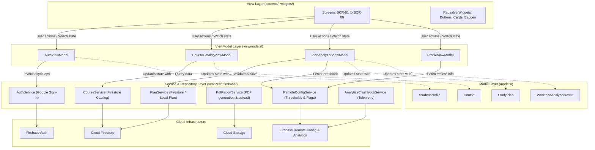
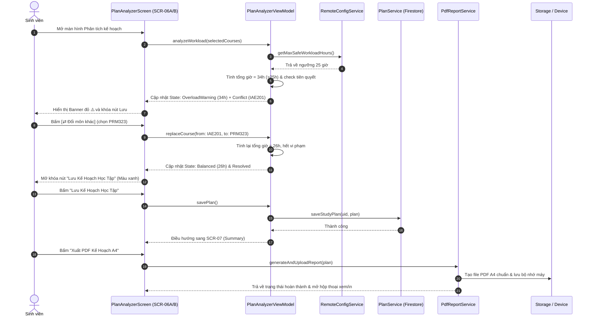

# EduPlan — System Architecture Documentation (Lab 3)

Tài liệu thiết kế kiến trúc phần mềm cho ứng dụng EduPlan theo mô hình **MVVM (Model-View-ViewModel)** nghiêm ngặt, kết hợp quản lý trạng thái bằng **Riverpod**.

---

## 1. Cấu trúc thư mục (Folder Structure)

```text
lib/
├── firebase/       # Khởi tạo và bao bọc các dịch vụ Firebase SDK (Auth, Firestore, Storage, Messaging, RemoteConfig)
├── models/         # Các lớp dữ liệu thực thể thuần (Course, StudentProfile, StudyPlan, PrerequisiteCheck)
├── services/       # Giao diện và tầng dịch vụ gọi mạng, cơ sở dữ liệu, PDF generator
├── theme/          # Hệ thống Design Tokens: AppColors, AppTypography, AppDimens, AppTheme
├── utils/          # Các tiện ích chuyển đổi dữ liệu, định dạng số, ngày tháng, logger
├── viewmodels/     # Tầng logic nghiệp vụ, giữ State của màn hình, lắng nghe Service và phát thông báo
├── widgets/        # Các thành phần giao diện tái sử dụng (Buttons, Cards, SearchBar, Badges, Banners)
└── screens/        # Các màn hình người dùng tương ứng từ SCR-01 đến SCR-08
```

---

## 2. Sơ đồ các tầng kiến trúc (MVVM Layer Diagram)

Các phụ thuộc tuân thủ nguyên tắc một chiều (chỉ trỏ xuống dưới, tầng dưới tuyệt đối không import tầng trên). Widget giao diện không bao giờ gọi trực tiếp Firebase hay HTTP.



---

## 3. Sơ đồ tuần tự cho Luồng Lập kế hoạch & Khắc phục Xung đột (Sequence Diagram)

Mô tả luồng từ khi người dùng thêm môn học, hệ thống phát hiện quá tải $\to$ khắc phục đổi môn $\to$ lưu kế hoạch và xuất PDF.



---

## 4. Bảng phân công ViewModels và Services (ViewModels & Injected Services)

| Tên ViewModel | Trách nhiệm chính | Các Services được Inject |
|:---|:---|:---|
| `AuthViewModel` | Quản lý trạng thái đăng nhập Google, phiên làm việc, phân quyền người dùng | `AuthService`, `AnalyticsCrashlyticsService` |
| `HomeViewModel` | Cung cấp dữ liệu trọng tâm tuần 8, các mẹo học tập, tiến độ tín chỉ | `StudentService`, `RemoteConfigService` |
| `CourseCatalogViewModel` | Tìm kiếm môn, lọc theo chuyên ngành, quản lý trạng thái loading/empty | `CourseService`, `AnalyticsCrashlyticsService` |
| `CourseDetailViewModel` | Cung cấp chi tiết môn, cấu trúc điểm 40/30/30, lựa chọn mục tiêu điểm | `CourseService` |
| `PlanAnalyzerViewModel` | Tính toán số giờ tự học, kiểm tra điều kiện tiên quyết, khóa/mở nút Lưu | `PlanService`, `RemoteConfigService`, `AnalyticsCrashlyticsService` |
| `SemesterSummaryViewModel` | Tổng hợp KPI kế hoạch kỳ học, kích hoạt xuất bản PDF A4, đánh dấu hoàn thành kỳ học chuyển môn sang completed_courses | `PlanService`, `StudentService`, `PdfReportService` |
| `ProfileViewModel` | Quản lý thiết lập thông báo, trạng thái Remote Config, hành động Đăng xuất, chỉnh sửa thông tin cá nhân | `AuthService`, `StudentService`, `RemoteConfigService` |
| `CompletedCoursesViewModel` | Quản lý danh mục môn đã học theo kỳ, kiểm tra ràng buộc kỳ học (kỳ 2 phải có kỳ 1) và môn tiên quyết | `StudentService`, `CourseService` |

---

## 5. Thiết kế Đa Persona & Quản lý Tiến độ Môn Học (Multi-Persona & Course Progression)

### 5.1. Mô hình Đa Persona & Xử lý Tài khoản Mới
1. **Persona 1: Trần Hoàng Long (Standard Student — Demo Lập kế hoạch & Quá tải)**
   - UID: `student_se180504` (Email: `longth.se180504@gmail.com` hoặc default)
   - Tích lũy: `90 / 145 TC`, GPA: `3.42`.
   - Dữ liệu: Kế hoạch Fall 2024 quá tải (34h/tuần, vi phạm IAE201) dùng để demo luồng đổi môn PRM323 sang 26h.
2. **Persona 2: Nguyễn Mai Linh (High-achiever — Demo Kế hoạch Kỳ cuối)**
   - UID: `student_se170123` (Email: `linhnm.se170123@gmail.com`)
   - Tích lũy: `125 / 145 TC`, GPA: `3.82`.
   - Dữ liệu: Đã hoàn thành Kỳ 1 đến Kỳ 7, kế hoạch kỳ tốt nghiệp Cân bằng (15h/tuần, 0 xung đột).
3. **Persona 3: Lê Minh Tuấn (Early-stage — Demo Rủi ro Học vụ)**
   - UID: `student_se190456` (Email: `tuanlm.se190456@gmail.com`)
   - Tích lũy: `35 / 145 TC`, GPA: `2.65`.
   - Dữ liệu: Sinh viên năm 2 đang chọn 38h/tuần và vi phạm 2 môn tiên quyết.
4. **Tài khoản mới không được định danh trước**:
   - Khi đăng nhập bằng tài khoản Google ngoài 3 tài khoản trên:
   - Dữ liệu khởi tạo là **Hồ sơ Rỗng** (`accumulatedCredits: 0`, `studentId: ''`, `passedCourseCodes: []`).
   - App hiển thị thông báo: *"Hồ sơ học tập mới - Chưa có dữ liệu. Vui lòng thiết lập thông tin cá nhân và cập nhật các môn học đã hoàn thành."*

### 5.2. Nghiệp vụ Nghiệm thu Kỳ học (SCR-07: "Đã Hoàn Thành Kỳ Học")
- Tại màn hình `SCR-07`, nút **"Đã Hoàn Thành Kỳ Học"** kích hoạt luồng:
  1. Đọc toàn bộ danh sách môn học đã chọn trong `study_plans/{planId}`.
  2. Ghi danh sách môn này vào collection `completed_courses/{uid}/courses/` với điểm số đạt chuẩn.
  3. Cộng dồn số tín chỉ của các môn này vào `accumulatedCredits` trong `students/{uid}`.
  4. Cập nhật trạng thái `isCompleted: true` cho bản kế hoạch.
  5. Điều hướng người dùng sang `SCR-03` để kiểm tra kết quả tiến độ tích lũy mới.

### 5.3. Nghiệp vụ Khai báo Môn Đã Học theo kỳ (SCR-03: Self-service Completed Courses)
- Cho phép sinh viên bắt đầu dùng app khi đã học một số kỳ tự khai báo môn đã hoàn thành.
- **2 Quy tắc ràng buộc cốt lõi (Enforced Business Rules)**:
  1. **Ràng buộc tiến trình kỳ học**: Kỳ $N$ chỉ được phép khai báo nếu Kỳ $1 \dots N-1$ đã có ít nhất một môn học hoàn thành ("kì 2 phải có kì 1"). Nếu người dùng chọn Kỳ 2 khi Kỳ 1 trống, hệ thống chặn lại và báo lỗi.
  2. **Ràng buộc điều kiện tiên quyết (Prerequisites)**: Môn học được thêm vào Kỳ $N$ bắt buộc phải có tất cả môn tiên quyết nằm trong tập hợp các môn đã hoàn thành ở các kỳ trước đó ($< N$). Nếu chưa đạt, hệ thống từ chối thêm môn và thông báo mã môn tiên quyết còn thiếu.

### 5.4. Nghiệp vụ Chỉnh sửa Thông tin Cá nhân (SCR-08: Edit Profile)
- Cho phép người dùng tự setup/chỉnh sửa:
  - Họ và tên (`fullName`)
  - Mã số sinh viên (`studentId`)
  - Ảnh đại diện (`avatarUrl` hoặc đồng bộ ảnh Google)
  - GPA mục tiêu (`targetGpa`) và Tổng tín chỉ tốt nghiệp (`totalGraduationCredits`)
- Cập nhật trực tiếp lên Firestore `students/{uid}` và đồng bộ ngay lên toàn bộ ứng dụng.

### 5.5. Kiến trúc Lập Kế Hoạch Vận Hành Thực Tế & Lưu Trữ Cục Bộ (Real-World Dynamic Planning & Local-First Persistence)
- **Tư duy thiết kế**: Ứng dụng phải hoạt động như một ứng dụng thực tế lâu dài cho người dùng cuối, loại bỏ sự phụ thuộc vào dữ liệu mẫu giả định cố định (static demo script).
- **Trạng thái khởi tạo linh hoạt (Zero-Course Start)**:
  - Cho phép kế hoạch bắt đầu từ trạng thái rỗng (`0 môn học`).
  - Khi chưa có môn nào: Màn hình Phân tích kế hoạch (`SCR-06A`) hiển thị Empty State thân thiện ("Chưa có môn nào trong kế hoạch kỳ này") cùng nút chuyển nhanh sang Course Catalog (`SCR-04`) để bắt đầu thêm môn.
- **Quy trình Thêm môn động & Nút `[+ Thêm môn]` trên SCR-06A**:
  - Sinh viên duyệt danh mục môn (`SCR-04`), xem cấu trúc & mẹo học tập (`SCR-05`), chọn mục tiêu điểm (A / B / PASS) và nhấn "Thêm vào Kế hoạch".
  - Tại `SCR-06A`, **nếu kế hoạch hợp lệ / không báo đỏ xung đột / chưa vượt ngưỡng quá tải**: Hệ thống hiển thị nút hành động **`[+ Thêm môn]`** ở góc trên bên phải AppBar để sinh viên tiếp tục chọn thêm các môn khác vào kỳ học.
  - Khi tiếp tục thêm môn, hệ thống liên tục tính toán lại tổng giờ tự học và đối chiếu cây môn tiên quyết cho đến khi vượt ngưỡng (báo đỏ) hoặc đạt kỳ vọng của sinh viên.
- **Lưu trữ Cục bộ (Local Persistence First)**:
  - Toàn bộ danh sách môn đã chọn trong kế hoạch đang lập dở phải được lưu trữ ở local (Riverpod persistent state kết hợp SharedPreferences / Local cache).
  - Khi người dùng điều hướng qua lại giữa các tab (Trang chủ, Đã học, Tìm môn, Cá nhân) hay tạm thời thoát ứng dụng, dữ liệu môn đã chọn vẫn được bảo toàn nguyên vẹn, không bị reset về danh sách mẫu.
- **Đồng bộ Lên Cloud Firestore (Cloud Sync on Resolution)**:
  - Chỉ khi kế hoạch đạt điều kiện an toàn (0 xung đột, hoặc sau khi người dùng đã giải quyết xong xung đột ở `SCR-06B`), nút "Lưu Kế Hoạch Học Tập" (Active màu xanh) mới kích hoạt ghi dữ liệu chính thức lên Cloud Firestore (`study_plans/{planId}`).
- **Nguyên lý Mở rộng Toàn Ứng Dụng (End-to-End Real App Experience)**:
  - Mọi chức năng khác đều vận hành dựa trên dữ liệu thật và quy tắc nghiệp vụ động (Dynamic rules): Tài khoản mới đăng nhập có luồng setup thông tin ban đầu, màn hình Môn đã học có luồng tự khai báo môn từng kỳ kèm validation tiên quyết chuẩn, màn hình Tổng kết kỳ tự động cập nhật tích lũy tín chỉ thật.

