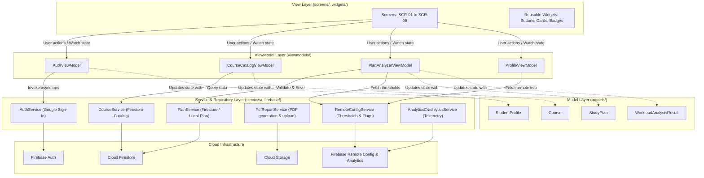
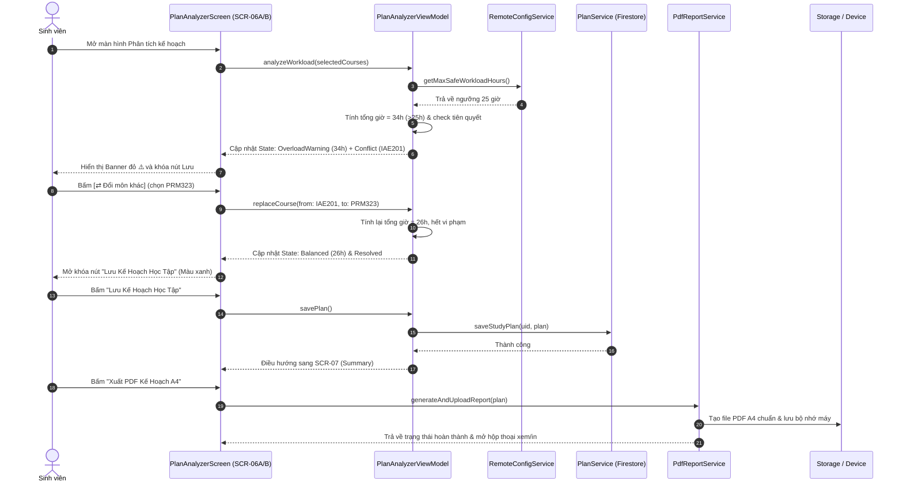

# EduPlan — System Architecture Documentation (Lab 3)

Tài liệu thiết kế kiến trúc phần mềm cho ứng dụng EduPlan theo mô hình **MVVM (Model-View-ViewModel)** nghiêm ngặt, kết hợp quản lý trạng thái bằng **Riverpod**.

---

## 1. Cấu trúc thư mục (Folder Structure)

```text
lib/
├── firebase/       # Khởi tạo và bao bọc các dịch vụ Firebase SDK (Auth, Firestore, Storage, Messaging, RemoteConfig)
├── models/         # Các lớp dữ liệu thực thể thuần (Course, StudentProfile, StudyPlan, PrerequisiteCheck)
├── services/       # Giao diện và tầng dịch vụ gọi mạng, cơ sở dữ liệu, PDF generator
├── theme/          # Hệ thống Design Tokens: AppColors, AppTypography, AppDimens, AppTheme
├── utils/          # Các tiện ích chuyển đổi dữ liệu, định dạng số, ngày tháng, logger
├── viewmodels/     # Tầng logic nghiệp vụ, giữ State của màn hình, lắng nghe Service và phát thông báo
├── widgets/        # Các thành phần giao diện tái sử dụng (Buttons, Cards, SearchBar, Badges, Banners)
└── screens/        # Các màn hình người dùng tương ứng từ SCR-01 đến SCR-08
```

---

## 2. Sơ đồ các tầng kiến trúc (MVVM Layer Diagram)

Các phụ thuộc tuân thủ nguyên tắc một chiều (chỉ trỏ xuống dưới, tầng dưới tuyệt đối không import tầng trên). Widget giao diện không bao giờ gọi trực tiếp Firebase hay HTTP.



---

## 3. Sơ đồ tuần tự cho Luồng Lập kế hoạch & Khắc phục Xung đột (Sequence Diagram)

Mô tả luồng từ khi người dùng thêm môn học, hệ thống phát hiện quá tải $\to$ khắc phục đổi môn $\to$ lưu kế hoạch và xuất PDF.



---

## 4. Bảng phân công ViewModels và Services (ViewModels & Injected Services)

| Tên ViewModel | Trách nhiệm chính | Các Services được Inject |
|:---|:---|:---|
| `AuthViewModel` | Quản lý trạng thái đăng nhập Google, phiên làm việc, phân quyền người dùng | `AuthService`, `AnalyticsCrashlyticsService` |
| `HomeViewModel` | Cung cấp dữ liệu trọng tâm tuần 8, các mẹo học tập, tiến độ tín chỉ | `StudentService`, `RemoteConfigService` |
| `CourseCatalogViewModel` | Tìm kiếm môn, lọc theo chuyên ngành, quản lý trạng thái loading/empty | `CourseService`, `AnalyticsCrashlyticsService` |
| `CourseDetailViewModel` | Cung cấp chi tiết môn, cấu trúc điểm 40/30/30, lựa chọn mục tiêu điểm | `CourseService` |
| `PlanAnalyzerViewModel` | Tính toán số giờ tự học, kiểm tra điều kiện tiên quyết, khóa/mở nút Lưu | `PlanService`, `RemoteConfigService`, `AnalyticsCrashlyticsService` |
| `SemesterSummaryViewModel` | Tổng hợp KPI kế hoạch kỳ học, kích hoạt xuất bản PDF A4 | `PlanService`, `PdfReportService` |
| `ProfileViewModel` | Quản lý thiết lập thông báo, trạng thái Remote Config, hành động Đăng xuất | `AuthService`, `RemoteConfigService` |
